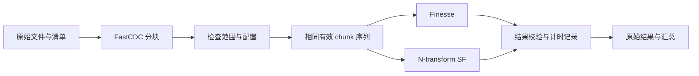

# 框架结构与模块职责

## 首期范围

`[已批准 D-01]` 首期实现 Finesse 与 N-transform SF 算法对比，预留完整系统接口。以下具体目录和模块设计为 `[已批准 D-10]`，首期代码现已建立；构建与测试说明见根目录 README。

```text
Finesse/
├── CMakeLists.txt
├── paper/
├── docs/
├── src/
│   ├── main.cpp
│   ├── Common/Types.h
│   ├── GearHash/GearHash.h, GearHash.cpp
│   ├── BreakingApart/BreakingApart.h, BreakingApart.cpp
│   ├── Finesse/Finesse.h, Finesse.cpp
│   ├── NTransform/NTransform.h, NTransform.cpp
│   ├── SuperFeature/SuperFeature.h, SuperFeature.cpp
│   ├── Experiment/Experiment.h, Experiment.cpp
│   └── Pipeline/Pipeline.h
├── tests/
├── configs/
└── results/                 # 实验产物，不存入源码模块
```

`Common` 只放两种算法共同使用的数据类型和常量，不成为杂项工具目录。`Pipeline.h` 首期只声明未来集成所需的逻辑契约，不引入未使用的编码器或数据库依赖。

| 模块 | 输入和输出 | 职责约束 |
| --- | --- | --- |
| GearHash | 字节和显式状态 → 指纹 | 仅负责哈希，不做分块、索引或计时 |
| BreakingApart | 原始文件及配置 → 切点 | 从 FastCDC 摘取；CDC 计时与 SF 计时分开 |
| Finesse | chunk + 哈希配置 → 原始 features、SF | 子块提取和排名分组，不含文件 I/O |
| NTransform | chunk + 哈希配置 + 参数表 → features、SF | 全块 N 次变换和连续分组 |
| SuperFeature | 有序 feature 元组 → SF | 统一序列化与哈希，不统一两种分组规则 |
| Experiment | 已批准配置和数据清单 → 实验记录 | 加载、输入校验、计时、结果消费、输出 |
| main | 命令行 → 调用 Experiment | 只做参数解析、错误提示、退出码 |
| Pipeline | chunk、签名、候选、编码结果 | 为后续系统定义边界，首期不实现完整管线 |

## 首期数据流



`[已批准 D-11 来源、D-12 协议；具体 CDC 配置见 D-16]` 输入清单在计时前确定，算法不能自行重排或抽样。两条路径各自计算 Gear；共享哈希实现和配置，但不共享已计算的指纹结果。诊断索引与核心 SF 计时分开。

## 后续完整系统边界

`[已批准 D-01：预留接口；实现细节待 D-13]`

```text
InputSource -> Chunker -> Deduplicator
    重复：写引用记录
    唯一：SF Extractor -> ResemblanceIndex -> BaseChunkReader -> DeltaCodec
                                                         -> ChunkStore
```

预留的数据应包含稳定 chunk ID、来源位置、原始长度、编码种类、可选基块 ID、编码结果长度。原始 chunk 与 Delta 编码结果不能混用同一个无标签字节数组。

未来必须能从存储记录恢复出原始内容，再做逐字节校验。是否允许 Delta 链、链深上限、负收益编码回退及索引插入资格，均未获批准。

## 实施阶段和门槛

| 阶段 | 内容 | 进入条件 | 完成证据 |
| --- | --- | --- | --- |
| M0 | 审核本套文档 | 已完成论文阅读 | 首期必需决策批准，哈希契约具体化 |
| M1 | 纯算法与共同类型 | 已批准的 D-04～D-08、D-10；D-14、D-15 已批准冻结 | Gear 已知答案、两算法参考实现与优化实现一致 |
| M2 | 实验驱动与输入适配 | 已批准 D-11 来源、D-12；D-16 已批准的 CDC 配置 | 相同输入、重复测量、完整结果清单 |
| M3 | 可选候选匹配诊断 | D-09 批准 | 查询顺序、同键冲突、无自身匹配测试 |
| M4 | 完整系统 | 另行批准 D-13 | 可恢复存储、压缩指标与端到端测量 |

首期不以 M4 完成作为验收条件。实验结果以 results/ 下实际运行记录为准，不承诺复现论文在旧硬件上的速度倍数。

复用来源与边界见 [08-fastcdc-reuse.md](08-fastcdc-reuse.md)。首期加入 FastCDC 输入适配不代表扩展到完整 Delta 压缩系统。Hash/ChunkStore 可作为后续去重输入预处理的复用来源，首期按 D-16 不启用去重输入模式。
