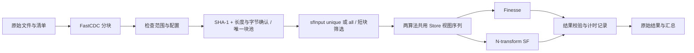

# 框架结构与模块职责

## 首期范围

`[已批准 D-01、D-21～D-24]` 当前有独立 SF 微基准与可恢复内存 Delta 入口；磁盘系统继续延后。以下模块已建立，构建与测试说明见根目录 README。

```text
Finesse/
├── CMakeLists.txt
├── paper/
├── docs/
├── src/
│   ├── main.cpp
│   ├── Common/Types.h, Types.cpp
│   ├── Algorithms/                   # 签名算法和 SF 组合
│   │   ├── Finesse/
│   │   ├── NTransform/
│   │   └── SuperFeature/
│   ├── Hashing/                      # 指纹更新和内容摘要
│   │   ├── GearHash/
│   │   └── Hash/
│   ├── Chunking/                     # CDC 和切点适配
│   │   └── BreakingApart/
│   ├── Compression/                  # 差分编解码包装
│   │   └── DeltaCodec/
│   ├── Storage/                      # 原文唯一池与编码池
│   │   ├── ChunkStore/
│   │   └── EncodedStore/
│   └── Runtime/                      # 实验驱动与候选索引
│       ├── Experiment/
│       └── Pipeline/
├── tests/
├── scripts/
├── configs/
├── third_party/xdelta/
└── results/                          # 实验产物，不存入源码模块
```

2026-11-12 按用户要求只调整项目结构：原有模块名称和文件保持，外层按算法、哈希、分块、压缩、存储和运行组织分类。`main.cpp` 与 Common 仍位于 src 下。本次全部源码（含 include、注释和用户已有的未提交改动）保持逐字节不变，函数职责和模块依赖也不拆分或重写。

CMake 显式源文件列表和 Gear 表摘要路径改用新位置；PUBLIC include 搜索目录包含 src 及上述六个分组目录，继续解析现有 `Finesse/Finesse.h`、`Hash/Hash.h`、`Experiment/Experiment.h` 等引用，不增设兼容头或软链接。src 下递归源码快照继续覆盖新结构。SHA-256 完整性工具仍在 Runtime/Experiment/IO 中，此次不拆文件或重新划分函数。

`Common` 只放两种算法共同使用的数据类型和常量，不成为杂项工具目录。`Pipeline` 实现候选索引；真实编码内容由 `EncodedStore` 拥有，`DeltaCodec` 调用静态 xdelta C 库，磁盘记录类型仍为预留。

| 模块 | 输入和输出 | 职责约束 |
| --- | --- | --- |
| GearHash | 字节和显式状态 → 指纹 | 仅负责哈希，不做分块、索引或计时 |
| Hash | 完整 chunk 字节 → SHA-1 | 精确查重的候选摘要；字节确认由 Store 完成 |
| ChunkStore | chunk 字节 → 唯一 storedId/出现分类 | 只复制新内容，重复引用同一 payload；跨文件、每实验独立 |
| BreakingApart | 原始文件及配置 → 切点 | 从 FastCDC 摘取；CDC 计时与 SF 计时分开 |
| Finesse | chunk + 哈希配置 → 原始 features、SF | 子块提取和排名分组，不含文件 I/O |
| NTransform | chunk + 哈希配置 + 参数表 → features、SF | 全块 N 次变换和连续分组 |
| SuperFeature | 有序 feature 元组 → SF | 统一序列化与哈希，不统一两种分组规则 |
| Experiment | 已批准配置和数据清单 → 实验记录 | 加载、输入校验、计时、结果消费、输出 |
| main | 命令行 → 调用 Experiment | 只做参数解析、错误提示、退出码 |
| Pipeline | 签名 → 可选候选、索引插入 | query/insert 分离，保留旧诊断 wrapper |
| DeltaCodec | base/target → VCDIFF；base/VCDIFF → 原文 | 固定上游 C API、容量检查、错误抛异常 |
| EncodedStore | 唯一原文池 → 每算法 Raw/Delta 池 | Raw-only FirstFit、编码后字节核验、正收益选择、仅从编码池恢复 |
| DeltaExperiment | 独立配置 → 质量与恢复证据 | 单次构建两池、销毁原文、全部出现恢复，输出计数/摘要/指标 |

## 首期数据流



`[已批准 D-11、D-12、D-16、D-21]` 输入清单先确定，所有出现仍可追溯。SHA-1/Store 在加载阶段执行，随后源缓冲释放；sfInput=unique 按首次出现选择，all 保留所有出现引用。两条路径从同一唯一池视图各自计算 Gear，不共享已计算指纹。CDC、精确去重和 SF 分开计时，诊断也在 SF 计时外。

## 内存 Delta 管线与磁盘后续边界

`[已批准 D-22～D-24：内存部分已实现；磁盘部分待 D-13]`

```text
InputSource -> Chunker -> Deduplicator
    重复：写引用记录
    唯一：SF Extractor -> 查询 Raw 索引 -> EncodedStore Raw 基块 -> DeltaCodec
                                                        -> EncodedStore Raw/Delta
                                                        -> 最终 Raw 才插入索引
```

预留的数据应包含稳定 chunk ID、来源位置、原始长度、编码种类、可选基块 ID、编码结果长度。原始 chunk 与 Delta 编码结果不能混用同一个无标签字节数组。

当前 EncodedStore 已从内容记录恢复原文：构建时 encode 后立即解码做逐字节比较；销毁原文池后全部出现再次恢复并校验 SHA-256。基块限以前的 Raw、深度 1，只有严格更小的 Delta 被接受；未匹配/短块/无收益均 Raw。候选索引仅插入最终合格 Raw，和旧全量诊断不同。

两算法独立编码池仅各自拥有 Raw 或 Delta payload；构造暂存原文池在作用域结束销毁，恢复接口没有原文池参数。共享出现元信息绑定相同 storedId，source 文件仅留下路径/长度/摘要。磁盘容器与 LRU 不在此内存恢复路径。

## 实施阶段和门槛

| 阶段 | 内容 | 进入条件 | 完成证据 |
| --- | --- | --- | --- |
| M0 | 审核本套文档 | 已完成论文阅读 | 首期必需决策批准，哈希契约具体化 |
| M1 | 纯算法与共同类型 | 已批准的 D-04～D-08、D-10；D-14、D-15 已批准冻结 | Gear 已知答案、两算法参考实现与优化实现一致 |
| M2 | 实验驱动与输入适配 | 已批准 D-11 来源、D-12；D-16 已批准的 CDC 配置 | 相同输入、重复测量、完整结果清单 |
| M3 | 可选候选匹配诊断 | D-09 批准 | 查询顺序、同键冲突、无自身匹配测试 |
| M3a | 精确去重与内存 Store 实际接入 | D-21 批准 | 摘要碰撞确认、相同 payload 同一地址、引用恢复、unique/all/replay 与真实数据统计 |
| M4a | 可恢复内存 Delta 管线 | D-22～D-24 已批准 | 真实编码、释放原文后恢复、单次质量指标 |
| M4b | 磁盘/并行完整系统 | 另行批准 D-13 | 磁盘容器、LRU、跨进程重载与稳定端到端测量 |

历史首期 M1～M3 不以完整 M4b 为验收条件；本次批准的 M4a 单独验收。实验结果以 results/ 下实际运行记录为准，不承诺复现论文在旧硬件上的速度倍数。

复用来源与边界见 [08-fastcdc-reuse.md](08-fastcdc-reuse.md)。Hash/ChunkStore 已按 D-21 适配接入内存存储；Delta 编解码与内存恢复见 [15](15-xdelta-pipeline-proposal.md)，磁盘格式/缓存/重载仍待 D-13。
