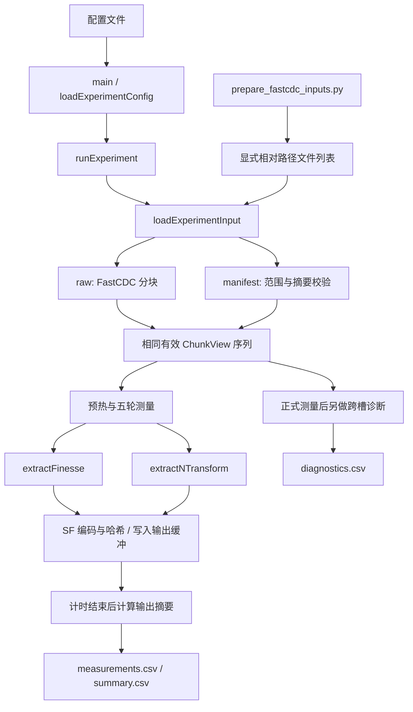

# Finesse 代码 Review 导读

面向你阅读当前仓库。本文说明代码在做什么、建议先读哪里，以及每一步应核对什么。依据是当前实现与 D-01～D-20 中已批准的首期决策；D-13 完整系统继续延后。

## 1. 先明确这次 Review 的目标

这套代码用于回答：**对完全相同的 chunk 输入，Finesse-Gear 与 NTransform-Gear 是否按规格生成签名，各自计算完整 SF 需要多少时间？**

你可以把 Review 分为三个判断：

1. **算法正确**：字节如何变成 feature，feature 如何分组并生成 SF，是否符合已批准规则。
2. **比较公平**：两算法是否使用相同输入、排除相同短块，计时范围和输出成本是否一致。
3. **结果可复核**：文件、边界、参数、构建与原始计时能否追溯，汇总能否独立重算。

当前实现覆盖算法、输入适配、实验驱动和候选匹配诊断。内容去重、Xdelta 编解码、基块缓存、持久化存储和恢复属于后续系统。`Pipeline.h` 中存在存储记录类型，并不表示这些能力已实现。

论文使用 Rabin，本项目按审批采用 Gear；Finesse feature 保留 64 位，NTransform 的变换结果保留 32 位后零扩展。这些是已经确定的实验语义。涉及这些行为的修改，应先对照 [决策记录](07-decisions.md)，将新歧义或论文与文档的冲突提交你确认。

## 2. 建议阅读顺序

建议先走完下表的前五步，形成整体认识，再深入输入、计时与异常处理。第一遍可以跳过 Gear 的 256 项表值和 CSV 解析细节。

| 顺序 | 阅读入口 | 这一步要回答的问题 |
| --- | --- | --- |
| 1 | [算法规格](02-algorithm-spec.md)、[决策记录](07-decisions.md) | 当前到底批准了哪些算法语义？哪些内容留待后续？ |
| 2 | [Common/Types.h](../src/Common/Types.h)、[Types.cpp](../src/Common/Types.cpp) | 输入、状态、feature、SF 的类型是什么？哪些配置固定？ |
| 3 | [Finesse.cpp](../src/Finesse/Finesse.cpp) | 一个 chunk 如何分成 12 个子块，又如何按排名组成 3 个 SF？ |
| 4 | [NTransform.cpp](../src/NTransform/NTransform.cpp)、[SuperFeature.cpp](../src/SuperFeature/SuperFeature.cpp) | 基线逐字节做了什么额外工作？两算法如何使用同一 SF 编码协议？ |
| 5 | [CoreTests.cpp](../tests/CoreTests.cpp) | 上述计算有哪些参考答案和边界测试？哪些假设仍需人工核对？ |
| 6 | [main.cpp](../src/main.cpp)、[Experiment.h](../src/Experiment/Experiment.h)、[Input.cpp](../src/Experiment/Input.cpp) | 配置和源文件如何变成两算法共用的输入？字节内存由谁持有？ |
| 7 | [Chunker.cpp](../src/BreakingApart/Chunker.cpp)、[BreakingApart.cpp](../src/BreakingApart/BreakingApart.cpp) | 分块是否完整、切点是否有进展，上游语义是否保留？ |
| 8 | [Experiment.cpp](../src/Experiment/Experiment.cpp) | 哪些操作被计时？预热、测量、摘要、统计和诊断如何分开？ |
| 9 | [Pipeline.cpp](../src/Pipeline/Pipeline.cpp)、[IO.cpp](../src/Experiment/IO.cpp) | 候选选择是否确定？损坏输入和 I/O 错误如何失败？ |
| 10 | [ExperimentTests.py](../tests/ExperimentTests.py)、[CMakeLists.txt](../CMakeLists.txt)、[数据说明](12-fastcdc-dataset.md) | CLI、重放、构建和当前四组数据是否与实验记录一致？ |

如果你只想先看算法，重点读 2～5；如果你要判断性能数字是否可信，还需要读 6～10。

## 3. 代码结构与模块目的

```text
src/
  main.cpp                   命令行入口与退出码
  Common/                    类型、固定配置、输入检查与子块边界
  GearHash/                  上游 Gear 表和更新原语
  BreakingApart/             上游 FastCDC 与本项目校验适配层
  Finesse/                   子块最大值提取、排名分组
  NTransform/                固定变换参数、逐字节变换、连续分组
  SuperFeature/              显式小端编码、统一 SF 哈希
  Experiment/
    Experiment.h             运行配置、源文件、chunk 记录的结构
    Input.cpp                配置读取、文件加载、CDC/清单重放
    IO.h / IO.cpp            二进制 I/O、CSV、SHA-256、溢出检查、路径解析
    Experiment.cpp           测量、输出消费、诊断调用、统计与结果导出
  Pipeline/                  已实现的诊断索引，以及后续系统的数据类型
tests/                       C++ 核心测试与 Python CLI 集成测试
scripts/                     输入列表准备与小型验收数据生成
configs/                     配置、固定参数、显式文件列表
cmake/BuildInfo.h.in          构建时元信息模板
results/                     运行产物，不参与算法实现
```

可以将依赖理解为：核心算法依赖 `Common`、`GearHash` 和 `SuperFeature`；`Experiment` 组织算法、输入与诊断；`main` 只负责调用。Python 用于测量前准备和测试，正式 C++ 提取路径不调用 Python。

GearHash 和 BreakingApart 的四个上游文件为原样摘取；`Chunker` 是新增适配层。核对迁移是否改变行为时，使用 [摘取记录](10-source-provenance.md) 中的固定提交和文件摘要。

## 4. 先沿一条完整路径走一遍

以 [DataSet_3 配置](../configs/fastcdc-dataset-3.conf) 为例：



实际调用中，`runExperiment` 先加载全部输入、准备 views 和输出缓冲，再开始提取循环。两算法复用边界与输入字节；各自重新扫描字节计算 Gear 状态。

阅读 `Experiment.cpp` 时，建议先找 `runExperiment`，暂时跳过文件顶部的元信息辅助函数，再依次展开 `loadExperimentInput`、`extract`、`outputDigest`、`runDiagnostics`。

## 5. 第一轮：审算法与数据契约

### 5.1 类型、所有权与失败状态

入口：[Types.h](../src/Common/Types.h)、[Types.cpp](../src/Common/Types.cpp)、[Experiment.h](../src/Experiment/Experiment.h)。

- `SourceFile.bytes` 拥有源文件内容；`InputChunk` 只保存文件索引、偏移和长度。
- `ChunkView` 借用字节指针，不拥有内存。views 在加载完成后创建；测量期间 `ExperimentInput` 持续存活，文件缓冲不再被改写。
- `SignatureResult` 按值返回，只有 `status == Ok` 时数组有效。非空长度配空指针为 `InvalidInput`；合法配置下长度小于 12 为 `UnsupportedLength`。
- `HashConfig` 表达固定协议。`validateHashConfig` 会拒绝改变 profile、状态位宽、初值、子块重置或编码方式等行为。

重点检查：是否有 view 活得比源缓冲更久；是否在获得有效状态前消费数组；是否把失败时的零数组当成合法签名。

### 5.2 区分三个 Gear 状态

| 使用位置 | 从何处开始 | 扫描什么 | 重置时机 |
| --- | --- | --- | --- |
| FastCDC | 当前块的最小长度跳过区间之后 | 用于切点判断的后续字节 | 每个 CDC 块开始 |
| 两种特征提取 | chunk 第一个字节 | chunk 全部字节，更新后取值 | 每个 chunk 开始；Finesse 子块边界不重置 |
| SF 哈希 | 4 个 feature 编码后的第一个字节 | 固定 32 字节 | 每个 SF 开始 |

重点检查 `gearRoll` 的 `(h << 1) + GEAR_TABLE[byte]` 是否保持 `uint64_t` 自然模运算，以及调用方是否正确管理状态。CDC 的中间状态不能直接拿来初始化特征提取。

### 5.3 Finesse：覆盖、极值与排名

入口：[Finesse.cpp](../src/Finesse/Finesse.cpp) 的 `extractFinesse`、`groupFinesseFeatures`，以及 `subchunkBoundary`。

先看特征提取：每个子块归约一个最大值，子块之间延续 Gear 状态。边界为 `floor(i*L/12)`，生产实现用商和余数避免 `i*L` 溢出。

你可以手工检查 `L=14`：边界应为 `0,1,2,3,4,5,7,8,9,10,11,12,14`。确认每个字节恰好落入一个区间，最后一个子块覆盖到末尾。

再看分组：12 个 feature 先分为 **4 个连续集合，每集合 3 个值**，每组稳定降序排序，取相同排名跨组组成 SF。原始 feature 数组保持子块顺序。

用 `features=[0,1,...,11]` 可直接核对：

```text
SF0 输入 = [2, 5, 8, 11]
SF1 输入 = [1, 4, 7, 10]
SF2 输入 = [0, 3, 6, 9]
```

对应测试：`testBoundaries`、`testGrouping`、`testExtraction`；图 3 的真实 feature 向量也在 `testGrouping` 中。

### 5.4 NTransform：每个位置都变换

入口：[NTransform.cpp](../src/NTransform/NTransform.cpp)。

重点追踪 `extractNTransform → transformFingerprint → groupNTransformFeatures`：每滚入一个字节，就对该位置的 Gear 低 32 位执行全部 12 对乘加变换；每个维度分别保留最大值。最后按原索引连续四个一组，不使用 Finesse 的排名规则。

核对三点：

1. 是否对每个字节位置做了变换，而不是只对整块最大值变换。
2. 乘加是否用明确的无符号类型，结果是否截为低 32 位后零扩展。
3. 参数是否与 [parameters-v1.csv](../configs/parameters-v1.csv) 以及 D-15 离线生成规则一致。

当前参数在 C++ 中保存一份，在版本化 CSV 中保存一份。`parameterCsv` 会检查导出值是否与构建时 CSV 摘要一致；Python 集成测试另按 SHA-256 生成规则核对数值。Review 时应把这条一致性检查也读完。

### 5.5 SF：明确编码，再做哈希

入口：[SuperFeature.cpp](../src/SuperFeature/SuperFeature.cpp)。每个值固定编码为 8 字节小端，四个值共 32 字节，Gear 从零状态取最后值。编码不依赖主机端序，也不直接哈希数组的内存布局。

SF 输入不包含槽号，以支持批准的跨槽匹配。两算法的分组方式各自决定，但编码和 SF 哈希协议共用。对应测试在 `testGrouping` 的字节向量检查、`referenceSF` 和 `testExtraction`。

## 6. 第二轮：审输入是否一致

入口：[prepare_fastcdc_inputs.py](../scripts/prepare_fastcdc_inputs.py)、[dataset_inputs.py](../scripts/dataset_inputs.py)、[Input.cpp](../src/Experiment/Input.cpp)、[Chunker.cpp](../src/BreakingApart/Chunker.cpp)。

当前四组取自同级 `../FastCDC/Dataset`：压缩包 5 个文件、源码 16982 个文件、tar 5 个文件、合成备份 8 个文件。第四组为 `synthetic`。详细版本和来源见 [当前数据说明](12-fastcdc-dataset.md)。

按下面顺序检查：

1. **枚举与筛选**：第二组递归，其他组当前层枚举；排除 `.DS_Store`/`._*`，保留重复内容，不改写原数据。准备脚本生成显式列表，C++ raw 模式不自行递归目录。
2. **路径基准**：配置中的 `inputPath` 相对配置目录；文件列表中的路径相对列表目录；manifest 中的路径相对 manifest 目录。`pathFrom` 处理规范化和已有路径别名，启动工作目录不决定数据位置。
3. **稳定顺序**：raw 模式规范化并排序文件路径，逐文件 CDC；重复路径报错。两个算法使用同一组有效 views。
4. **切点语义**：上游在字节 `i` 命中后切于 `i`，当前块为 `[last,i)`；用于判定的字节不在当前块中。适配层检查切点严格递增、范围合法、末切点覆盖文件长度。
5. **短块统计**：两个算法共同排除长度小于 12 的块，记录原输入中的数量和字节数。空文件产生零块，但仍进入完整源文件摘要记录。

`manifest` 模式按行顺序读取，验证 ID 唯一、范围、整数溢出和严格的摘要集合。它不会重新做 CDC，也不强制要求区间连续：同一区间可以用不同 chunk ID 重复输入。因此应区分“raw 导出的完整分块清单”和“加载一个范围合法的外部清单”。

`checksums.csv` 包含清单及实际被引用的源文件；`source-checksums.csv` 另记录全部加载源文件，包括空文件。这里对应 D-18。

## 7. 第三轮：审计时与统计

入口：[Experiment.cpp](../src/Experiment/Experiment.cpp) 的 `runExperiment`，对照 [实验协议](06-experiments.md)。

### 7.1 先画出计时边界

```text
计时前：加载文件、SHA-256、CDC、有效 views、输出缓冲分配
开始 steady_clock
    对 iterations 次完整输入遍历：
        调用完整提取函数，结果写入预分配 SignatureResult 缓冲
结束 steady_clock
计时后：检查结果状态、计算输出摘要、写测量 CSV
全部正式测量后：另做候选诊断，再生成统计汇总
```

完整提取调用包含入口校验、Gear 扫描、feature 提取、分组和 SF 哈希。两算法都承担相同结构的结果保存成本。检查时尤其注意有没有把其中一条路径的计算提前到计时外。

循环中的 `repetition=0` 是每算法各一次预热，不写入正式测量 CSV；`1..5` 为正式轮次。正式奇数轮 Finesse 先、偶数轮 NTransform 先，单线程执行。

### 7.2 摘要能证明什么

`outputDigest` 在计时后消费所有结果，按固定顺序将 features 和 SF 编成小端字节，再计算 SHA-256。同一算法各轮应与自身预热摘要一致。

这检查重复执行是否确定，也使输出被实际消费。它不能单独证明算法符合规格；正确性仍需参考实现和已知答案。两个算法的摘要不要求互相相等。

### 7.3 对着原始数据重算

| 项目 | 当前口径 |
| --- | --- |
| `inputBytes` / `chunkCount` | 原输入集合一次遍历的字节数 / 总块数 |
| `excludedBytes` / `excludedChunks` | 原输入中短块的字节数 / 数量，不乘 iterations |
| `processedBytes` | `(inputBytes - excludedBytes) * iterations` |
| 单次速度 | `processedBytes / (elapsedNs / 1e9)` |
| `meanBytesPerSecond` | 五次单次速度的算术平均 |
| `stddevSeconds` / `stddevBytesPerSecond` | 五次数据的总体标准差，分母为 5 |
| 主要速度比 | `mean(NTransform seconds) / mean(Finesse seconds)` |
| MB/s | bytes/s 除以 10⁶ |

尤其区分“单次速度的均值”和“字节数除以平均耗时”，两者一般不同。`ExperimentTests.py` 用 Python `statistics.pstdev` 对照重算。

没有有效输入时整次运行失败，不生成零分母性能结论。Review 时先确认两算法的 `processedBytes` 相同，再比较耗时和速度比。

## 8. 第四轮：审诊断、失败与复现

### 8.1 候选选择规则

入口：[Pipeline.cpp](../src/Pipeline/Pipeline.cpp) 的 `queryThenInsert`，以及 `runDiagnostics`。

索引以 SF 值为键，跨槽查询。当前 chunk 按槽 0、1、2 查询，找到第一个命中后停止；同键保存最早插入的历史 chunk，同一历史块重复槽保留最小槽号。先查后插，不能与自己或未来数据匹配。

“最早”指插入顺序，不是最小 chunk ID；当前查询槽的优先级先于不同键之间的历史时间比较。每个算法独立建立索引，profile 必须匹配。共享 SF 只产生候选，不证明内容相同或存在压缩收益。

### 8.2 失败是否可见

入口：[main.cpp](../src/main.cpp)、[IO.cpp](../src/Experiment/IO.cpp)、`runExperiment` 的异常分支。

重点核对：配置是否拒绝未知、重复、缺失键；二进制读取不足是否失败；CSV 是否正确处理引号、逗号、换行和 UTF-8；`offset+length`、累计字节和乘法是否经过溢出检查。

失败还要按阶段区分：配置加载失败时返回非零退出码，不一定已创建结果目录；结果目录已存在时拒绝覆盖；新目录创建后的运行异常会尽力写 `status=failed` 并移除正常汇总。因此检查一组产物时，应先读 `run.txt` 的状态，不能仅凭存在部分 `measurements.csv` 判断成功。

### 8.3 复现记录由哪里产生

入口：[CMakeLists.txt](../CMakeLists.txt)、[BuildInfo.h.in](../cmake/BuildInfo.h.in)、`exportInput`、`parameterCsv`。

- 构建阶段生成代码 revision 或源码摘要、构建选项，以及 `source-files.csv` 内容；运行时导出实际输入清单、源文件摘要和参数。
- `manifest.csv` 重放依赖原文件仍可访问，结果目录并没有备份全部原始数据。
- `validation.txt`、`provenance.txt` 是此前核验过程中另存的证据，当前 CLI 不自动生成这两个文件；正式统计文件由程序生成。
- 文档也被纳入构建摘要。本导读加入后，下一次构建的摘要可能变化；历史 v1 结果对应当时保存的快照，核对时应按该次记录解释。

## 9. 测试应该怎样配合阅读

测试目标只有两个，但内部包含多项检查。不要把 CTest 的“2/2”理解为只有两个测试用例。

| 阅读主题 | 对应测试 |
| --- | --- |
| Gear、批量与分批更新、已知答案 | `CoreTests.cpp::testGear` |
| 子块余数、全覆盖、极大长度 | `testBoundaries` |
| 图 3 分组、重复值、字节编码 | `testGrouping` |
| 两算法参考实现、短块、非法配置、状态隔离、模运算 | `testExtraction`、`referenceSignature` |
| 空文件、短尾块、强制最大块、上游切点比较、拒绝零最小长度 | `testCDC` |
| 跨槽、最早插入、重复 ID、算法隔离 | `testIndex` |
| CSV、UTF-8、SHA-256 已知答案、整数错误 | `testIO` |
| CLI、清单重放、参数生成规则、汇总重算、损坏输入与失败产物 | `ExperimentTests.py` |

参考实现预先构造 Gear 序列，再用较直观的归约与排序检查生产实现；预计算只用于测试，不用于正式提速。它仍共用 Gear 表和固定参数来源，因此表值和参数还需要结合来源摘要、已知答案与离线生成规则核对。

Release 下使用 `require/check` 显式报错，不依赖可能被 `NDEBUG` 关闭的 `assert`。Debug 的 ASan/UBSan 用于发现越界与未定义行为；Release 用于性能测量。

从项目根目录执行构建与检查，命令见 [根目录 README](../README.md)。建议先运行：

```sh
cmake --build build/release -j 4
ctest --test-dir build/release --output-on-failure
```

若要断点看单块算法，用 Debug 的 `finesse_tests`，在 `extractFinesse` / `extractNTransform` 下断点，从 `testExtraction` 的 12、13、14 字节输入开始观察。这样不用先跑完整四组数据。

若要重跑数据集，复制一份配置，为 `runId` 和 `outputDirectory` 选择新值。现有四组结果目录已经存在，程序会拒绝覆盖。调试时的耗时与 Release 正式结果分开解释。

## 10. Review 时优先记录哪些问题

建议先记录会改变签名、输入集合或性能口径的问题，再处理组织与命名。每条意见写清“位置、观察到的行为、规格依据、影响、建议如何验证”。

| 优先级 | 关注点 |
| --- | --- |
| 高 | 漏扫字节、状态重置错误、分组错误、模运算/编码错误、悬空 view、两算法输入不同、计时范围不同 |
| 中 | 错误被静默忽略、短块计数错误、候选顺序错误、摘要或重放不完整、失败产物容易误读 |
| 后续讨论 | 逐 chunk 配置检查的成本、C++/CSV 双份参数维护、Experiment.cpp 职责集中、平台信息代码的可移植性 |

内存也值得单独看：当前输入整组驻留；输出缓冲按“有效块数 × iterations”增长，摘要和诊断还会申请额外内存。尚未实现分批/流式模式。这里应评估预期数据规模与失败行为，不能仅看源文件总大小。

上述“后续讨论”是建议审视的取舍，不是已确认缺陷。涉及算法语义、实验口径或后续系统的改变，按既有审批要求先提交你确认。

下面这份清单可直接用于本次 Review 记录：

- [ ] 我能从一个 chunk 的字节追踪到 12 个 features 和 3 个 SF。
- [ ] 我确认三个 Gear 使用位置的状态没有混用。
- [ ] 我确认 Finesse 的覆盖与排名、NTransform 的逐位置变换符合批准规格。
- [ ] 我确认两算法使用同一有效输入集合，原始字节的生命周期覆盖全部调用。
- [ ] 我确认相对路径的解析基准、四组数据分类和元数据排除规则。
- [ ] 我能指出计时开始与结束的位置，并解释计时内、外各有哪些操作。
- [ ] 我能从 measurements.csv 重算 summary.csv，并解释速度比的含义。
- [ ] 我确认诊断先查后插，候选规则确定，算法索引相互隔离。
- [ ] 我确认非法输入和运行失败可以被识别，既有结果不会被覆盖。
- [ ] 我区分了自动测试、此前核验记录、当前限制和 D-13 后续范围。
