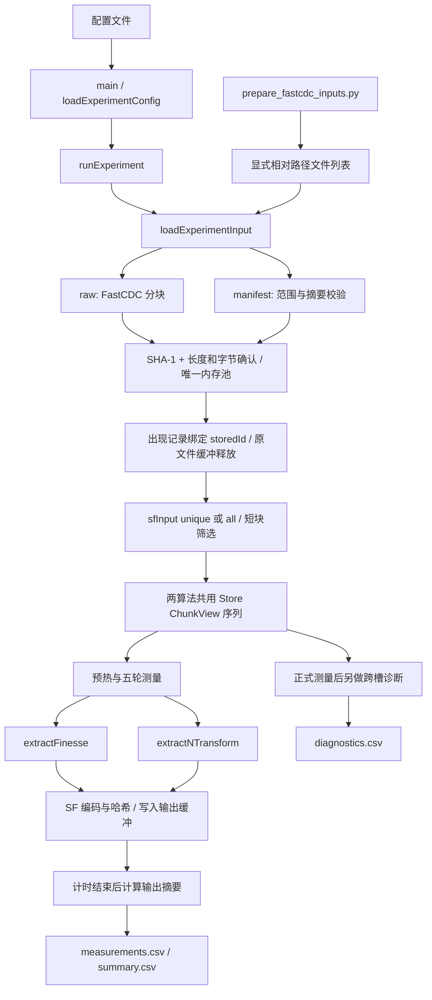

# Finesse 代码 Review 导读

面向你阅读当前仓库。本文说明代码在做什么、建议先读哪里，以及每一步应核对什么。依据是当前实现及 D-21～D-24：SHA-1 精确去重、唯一块 SF，以及真正的 xdelta Raw/Delta 内存编码与恢复。磁盘容器、400MB LRU、跨进程重载和并行仍待 D-13。

## 1. 先明确这次 Review 的目标

这套代码先把内容完全相同的 chunk 绑定到一份内存 payload，再回答：**对同一组 Store 视图，Finesse-Gear 与 NTransform-Gear 是否按规格生成签名，各自计算完整 SF 需要多少时间？** 默认集合为唯一块，all 则遍历每次原始出现的引用。

你可以把 Review 分为三个判断：

1. **内容与算法正确**：精确重复是否只存一份，SHA-1 碰撞是否保留不同内容；feature/SF 是否符合批准规则；原文释放后 `A=decode(B,Delta)` 是否仍成立。
2. **比较公平**：两算法是否使用相同输入、排除相同短块，计时范围和输出成本是否一致。
3. **结果可复核**：文件、边界、参数、构建与原始计时能否追溯，汇总能否独立重算。

当前有两个入口：`--config` 做原 SF 五轮微基准，`--delta-config` 做真实编码和一次质量/恢复验收。ChunkStore 保存构建输入的唯一原文；EncodedStore 保存最终 Raw 或 Delta。两算法各自构造池，释放原文后仅从自己的 Raw 基块和 Delta 恢复全部出现；磁盘缓存/重载未实现。

论文使用 Rabin，本项目按审批采用 Gear；Finesse feature 保留 64 位，NTransform 的变换结果保留 32 位后零扩展。这些是已经确定的实验语义。涉及这些行为的修改，应先对照 [决策记录](07-decisions.md)，将新歧义或论文与文档的冲突提交你确认。

函数前已按你的审查习惯补充三行中文说明：第一行说明用途，`输入` 列参数与必要前提，`输出` 列返回含义及状态回写、文件写入或错误行为。头文件可先看接口契约，定义处可就地对照实现；测试和脚本中的局部命名函数也采用同样说明。third_party/xdelta 按你明确选择保留上游原样。

## 2. 建议阅读顺序

建议先走完下表的前五步，形成整体认识，再深入输入、计时与异常处理。第一遍可以跳过 Gear 的 256 项表值和 CSV 解析细节。

| 顺序 | 阅读入口 | 这一步要回答的问题 |
| --- | --- | --- |
| 1 | [算法规格](02-algorithm-spec.md)、[决策记录](07-decisions.md) | 当前到底批准了哪些算法语义？哪些内容留待后续？ |
| 2 | [Common/Types.h](../src/Common/Types.h)、[Types.cpp](../src/Common/Types.cpp) | 输入、状态、feature、SF 的类型是什么？哪些配置固定？ |
| 3 | [Finesse.cpp](../src/Finesse/Finesse.cpp) | 一个 chunk 如何分成 12 个子块，又如何按排名组成 3 个 SF？ |
| 4 | [NTransform.cpp](../src/NTransform/NTransform.cpp)、[SuperFeature.cpp](../src/SuperFeature/SuperFeature.cpp) | 基线逐字节做了什么额外工作？两算法如何使用同一 SF 编码协议？ |
| 5 | [CoreTests.cpp](../tests/CoreTests.cpp) | 上述计算有哪些参考答案和边界测试？哪些假设仍需人工核对？ |
| 5a | [Hash.cpp](../src/Hash/Hash.cpp)、[ChunkStore.cpp](../src/ChunkStore/ChunkStore.cpp)、[ChunkStoreTests.cpp](../tests/ChunkStoreTests.cpp) | 整块 SHA-1 如何查候选？碰撞如何区分？重复是否复用同一地址？ |
| 5b | [Delta 规格](15-xdelta-pipeline-proposal.md)、[DeltaCodec.cpp](../src/DeltaCodec/DeltaCodec.cpp) | 调用的是哪份上游代码？base/target 方向、级别、校验、错误如何处理？ |
| 5c | [EncodedStore.cpp](../src/EncodedStore/EncodedStore.cpp)、[DeltaStoreTests.cpp](../tests/DeltaStoreTests.cpp) | A 的原文何时释放？Delta 是否仅保存 payload/baseId？怎样证明能从池恢复？ |
| 5d | [DeltaExperiment.cpp](../src/Experiment/DeltaExperiment.cpp)、[DeltaExperimentTests.py](../tests/DeltaExperimentTests.py) | 新入口是否单次、独立构造两池、释放原文后恢复全部出现？ |
| 6 | [main.cpp](../src/main.cpp)、[Experiment.h](../src/Experiment/Experiment.h)、[Input.cpp](../src/Experiment/Input.cpp) | raw/manifest 如何接入唯一池？源缓冲释放后如何由 storedId 读取？unique/all 如何选择？ |
| 7 | [Chunker.cpp](../src/BreakingApart/Chunker.cpp)、[BreakingApart.cpp](../src/BreakingApart/BreakingApart.cpp) | 分块是否完整、切点是否有进展，上游语义是否保留？ |
| 8 | [Experiment.cpp](../src/Experiment/Experiment.cpp) | 哪些操作被计时？预热、测量、摘要、统计和诊断如何分开？ |
| 9 | [Pipeline.cpp](../src/Pipeline/Pipeline.cpp)、[IO.cpp](../src/Experiment/IO.cpp) | 候选选择是否确定？损坏输入和 I/O 错误如何失败？ |
| 10 | [ExperimentTests.py](../tests/ExperimentTests.py)、[DeduplicationTests.py](../tests/DeduplicationTests.py)、[CMakeLists.txt](../CMakeLists.txt)、[数据说明](12-fastcdc-dataset.md) | CLI、重放、构建和当前四组数据是否与实验记录一致？ |

只看算法可读 2～5；本次真实 Delta Review 建议先读 5a～5d 和本文第 11 节，再读候选索引。判断 SF 性能还需要 6～10。

## 3. 代码结构与模块目的

```text
src/
  main.cpp                   命令行入口与退出码
  Common/                    类型、固定配置、输入检查与子块边界
  GearHash/                  上游 Gear 表和更新原语
  Hash/                      完整 SHA-1 摘要、编码与容器桶号
  ChunkStore/                精确查重、唯一原文 payload、读取、计数与 reset
  DeltaCodec/                固定 xdelta C 内存 API、VCDIFF 编解码
  EncodedStore/              实际 Raw/Delta payload、资格与正收益、只依赖编码池恢复
  BreakingApart/             上游 FastCDC 与本项目校验适配层
  Finesse/                   子块最大值提取、排名分组
  NTransform/                固定变换参数、逐字节变换、连续分组
  SuperFeature/              显式小端编码、统一 SF 哈希
  Experiment/
    Experiment.h             运行配置、源文件、chunk 记录的结构
    Input.cpp                配置、加载、CDC/清单重放、入池和 SF 集合选择
    IO.h / IO.cpp            二进制 I/O、CSV、SHA-256、溢出检查、路径解析
    Experiment.cpp           SF 测量、诊断、统计、共用输入元信息导出
    DeltaExperiment.cpp      独立 Delta 配置、构造/释放/恢复、质量产物
  Pipeline/                  查询/插入分离的 FirstFit 索引，旧诊断 wrapper
third_party/xdelta/          原样上游源码/许可证、来源与完整性清单
tests/                       C++ 核心测试与 Python CLI 集成测试
scripts/                     输入列表准备与小型验收数据生成
configs/                     配置、固定参数、显式文件列表
cmake/BuildInfo.h.in          构建时元信息模板
results/                     运行产物，不参与算法实现
```

可以将依赖理解为：核心算法依赖 `Common`、`GearHash` 和 `SuperFeature`；`Experiment` 组织算法、输入与诊断；`main` 只负责调用。Python 用于测量前准备和测试，正式 C++ 提取路径不调用 Python。

GearHash 和 BreakingApart 的四个文件最初为原样摘取，当前本地副本已补充函数阅读注释；GearHash.cpp 还保留用户审查时对 length 增加的顶层 const；`Chunker` 是新增适配。Hash/ChunkStore 参考同一固定 FastCDC 提交的 EVP SHA-1、候选桶与字节确认，适配为显式状态和 ID 引用。核对迁移是否改变行为时，使用 [摘取记录](10-source-provenance.md) 中的固定提交和文件摘要。

## 4. 先沿一条完整路径走一遍

以 [DataSet_3 配置](../configs/fastcdc-dataset-3.conf) 为例：



`loadExperimentInput` 在加载阶段完成 CDC/重放、SHA-1、精确确认及唯一存储，返回前释放源文件缓冲。`runExperiment` 再选择集合、准备 Store 视图和输出缓冲。两算法复用池内字节与同一序列，各自扫描计算 Gear。

阅读 `Experiment.cpp` 时，建议先找 `runExperiment`，暂时跳过文件顶部的元信息辅助函数，再依次展开 `loadExperimentInput`、`extract`、`outputDigest`、`runDiagnostics`。

## 5. 第一轮：审算法与数据契约

### 5.1 类型、所有权与失败状态

入口：[Types.h](../src/Common/Types.h)、[Types.cpp](../src/Common/Types.cpp)、[Experiment.h](../src/Experiment/Experiment.h)。

- `SourceFile` 仅保存原文件路径、长度与 SHA-256；完整源缓冲只在加载阶段暂存。
- `StoredChunk.bytes` 拥有唯一 payload，`InputChunk` 保存每次出现的来源、范围、storedId 和 isDuplicate；原始 chunkId 与池内 storedId 分离。
- `ChunkView` 借用池内字节，创建 views 时源缓冲已经释放。Store 必须持续存活，期间不 reset、不改写 payload；普通追加保持旧视图有效。
- `SignatureResult` 按值返回，只有 `status == Ok` 时数组有效。非空长度配空指针为 `InvalidInput`；合法配置下长度小于 12 为 `UnsupportedLength`。
- `HashConfig` 表达固定协议。`validateHashConfig` 会拒绝改变 profile、状态位宽、初值、子块重置或编码方式等行为。

重点检查：view 是否来自唯一池而非已释放源缓冲、生命周期是否超过 Store；是否在获得有效状态前消费数组；是否把失败时的零数组当成合法签名。

### 5.2 区分三个 Gear 状态

| 使用位置 | 从何处开始 | 扫描什么 | 重置时机 |
| --- | --- | --- | --- |
| FastCDC | 当前块的最小长度跳过区间之后 | 用于切点判断的后续字节 | 每个 CDC 块开始 |
| 两种特征提取 | chunk 第一个字节 | chunk 全部字节，更新后取值 | 每个 chunk 开始；Finesse 子块边界不重置 |
| SF 哈希 | 4 个 feature 编码后的第一个字节 | 固定 32 字节 | 每个 SF 开始 |

重点检查 `gearRoll` 的 `(h << 1) + GEAR_TABLE[byte]` 是否保持 `uint64_t` 自然模运算，以及调用方是否正确管理状态。CDC 的中间状态不能直接拿来初始化特征提取。

### 5.3 Finesse：覆盖、极值与排名

入口：[Finesse.cpp](../src/Finesse/Finesse.cpp) 的 `extractFinesse`、`groupFinesseFeatures`，以及 `subchunkBoundary`。

先看特征提取：每个子块归约一个最大值，子块之间延续 Gear 状态。边界为 `floor(i*L/12)`，生产实现用商和余数避免 `i*L` 溢出。

你可以手工检查 `L=14`：边界应为 `0,1,2,3,4,5,7,8,9,10,11,12,14`。确认每个字节恰好落入一个区间，最后一个子块覆盖到末尾。

再看分组：12 个 feature 先分为 **4 个连续集合，每集合 3 个值**，每组稳定降序排序，取相同排名跨组组成 SF。原始 feature 数组保持子块顺序。

用 `features=[0,1,...,11]` 可直接核对：

```text
SF0 输入 = [2, 5, 8, 11]
SF1 输入 = [1, 4, 7, 10]
SF2 输入 = [0, 3, 6, 9]
```

对应测试：`testBoundaries`、`testGrouping`、`testExtraction`；图 3 的真实 feature 向量也在 `testGrouping` 中。

### 5.4 NTransform：每个位置都变换

入口：[NTransform.cpp](../src/NTransform/NTransform.cpp)。

重点追踪 `extractNTransform → transformFingerprint → groupNTransformFeatures`：每滚入一个字节，就对该位置的 Gear 低 32 位执行全部 12 对乘加变换；每个维度分别保留最大值。最后按原索引连续四个一组，不使用 Finesse 的排名规则。

核对三点：

1. 是否对每个字节位置做了变换，而不是只对整块最大值变换。
2. 乘加是否用明确的无符号类型，结果是否截为低 32 位后零扩展。
3. 参数是否与 [parameters-v1.csv](../configs/parameters-v1.csv) 以及 D-15 离线生成规则一致。

当前参数在 C++ 中保存一份，在版本化 CSV 中保存一份。`parameterCsv` 会检查导出值是否与构建时 CSV 摘要一致；Python 集成测试另按 SHA-256 生成规则核对数值。Review 时应把这条一致性检查也读完。

### 5.5 SF：明确编码，再做哈希

入口：[SuperFeature.cpp](../src/SuperFeature/SuperFeature.cpp)。每个值固定编码为 8 字节小端，四个值共 32 字节，Gear 从零状态取最后值。编码不依赖主机端序，也不直接哈希数组的内存布局。

SF 输入不包含槽号，以支持批准的跨槽匹配。两算法的分组方式各自决定，但编码和 SF 哈希协议共用。对应测试在 `testGrouping` 的字节向量检查、`referenceSF` 和 `testExtraction`。

## 6. 第二轮：审输入是否一致

入口：[prepare_fastcdc_inputs.py](../scripts/prepare_fastcdc_inputs.py)、[dataset_inputs.py](../scripts/dataset_inputs.py)、[Input.cpp](../src/Experiment/Input.cpp)、[Chunker.cpp](../src/BreakingApart/Chunker.cpp)。

当前四组取自同级 `../FastCDC/Dataset`：压缩包 5 个文件、源码 16982 个文件、tar 5 个文件、合成备份 8 个文件。第四组为 `synthetic`。详细版本和来源见 [当前数据说明](12-fastcdc-dataset.md)。

按下面顺序检查：

1. **枚举与筛选**：第二组递归，其他组当前层枚举；排除 `.DS_Store`/`._*`，保留所有出现记录，不改写原数据。准备脚本生成显式列表，C++ raw 模式不自行递归目录。
2. **路径基准**：配置中的 `inputPath` 相对配置目录；文件列表中的路径相对列表目录；manifest 中的路径相对 manifest 目录。`pathFrom` 处理规范化和已有路径别名，启动工作目录不决定数据位置。
3. **稳定顺序**：raw 模式规范化并排序文件路径，逐文件 CDC；重复路径报错。随后按出现顺序入池，unique 取首次出现，all 取全部引用，两个算法读取同一组有效 views。
4. **切点语义**：上游在字节 `i` 命中后切于 `i`，当前块为 `[last,i)`；用于判定的字节不在当前块中。适配层检查切点严格递增、范围合法、末切点覆盖文件长度。
5. **短块统计**：短块仍参与精确存储，两个算法只在 SF 集合中共同排除长度小于 12 的块。全部原始出现与所选集合分别统计。raw 空文件产生零块，仍记录源文件摘要。

`manifest` 模式按行顺序读取，验证 ID 唯一、范围、整数溢出和严格的摘要集合。它不会重新做 CDC，也不强制要求区间连续：同一区间可以用不同 chunk ID 重复输入。因此应区分“raw 导出的完整分块清单”和“加载一个范围合法的外部清单”。

`checksums.csv` 包含清单及实际被引用的源文件；`source-checksums.csv` 另记录全部加载源文件，包括空文件。这里对应 D-18。

### 6.1 重点追一遍“相同块只存一份”

调用顺序为 `bindChunk → storeChunk → findInBucket`。`sha1` 计算完整字节的 20 字节摘要，候选桶中还要比较长度和全部字节。确认为重复时仅返回旧 storedId 并增加 referenceCount，新内容才复制 payload。

例如 chunkId 为 9、7、20 的三次出现，内容都为同一个 100 字节块：唯一池应只有 storedId=0、100 字节 payload、引用次数为 3，三个出现的 firstChunkId 都为 9。unique 的 SF 字节数为 100，all 为 300，再各乘 iterations；两种模式都只存这 100 字节一次。

重点检查：同 SHA-1 但内容不同是否分别存储；索引分配失败时是否回滚新 payload；只读查询是否不计数；reset 是否使旧视图失效；预热和测量是否没有重新向 Store 发射块。生产固定 SHA-1，碰撞测试才注入强制同摘要函数。

`stored-chunks.csv` 应一行一个唯一内容；`chunk-references.csv` 应完整保留所有原始出现及首次 chunkId。`DeduplicationTests.py` 独立按实际字节验证唯一集合、SHA-1、引用恢复和计数，指针地址复用由 `ChunkStoreTests.cpp` 验证。接口与全部计数定义见 [D-21](14-sha1-chunk-store.md)。

## 7. 第三轮：审计时与统计

入口：[Experiment.cpp](../src/Experiment/Experiment.cpp) 的 `runExperiment`，对照 [实验协议](06-experiments.md)。

### 7.1 先画出计时边界

```text
计时前：加载文件、SHA-256、CDC、SHA-1 精确去重与入池、释放源缓冲、所选 views、输出缓冲分配
开始 steady_clock
    对 iterations 次完整输入遍历：
        调用完整提取函数，结果写入预分配 SignatureResult 缓冲
结束 steady_clock
计时后：检查结果状态、计算输出摘要、写测量 CSV
全部正式测量后：另做候选诊断，再生成统计汇总
```

完整提取调用包含入口校验、Gear 扫描、feature 提取、分组和 SF 哈希。两算法都承担相同结构的结果保存成本。检查时尤其注意有没有把其中一条路径的计算提前到计时外。

循环中的 `repetition=0` 是每算法各一次预热，不写入正式测量 CSV；`1..5` 为正式轮次。正式奇数轮 Finesse 先、偶数轮 NTransform 先，单线程执行。

### 7.2 摘要能证明什么

`outputDigest` 在计时后消费所有结果，按固定顺序将 features 和 SF 编成小端字节，再计算 SHA-256。同一算法各轮应与自身预热摘要一致。

这检查重复执行是否确定，也使输出被实际消费。它不能单独证明算法符合规格；正确性仍需参考实现和已知答案。两个算法的摘要不要求互相相等。

### 7.3 对着原始数据重算

| 项目 | 当前口径 |
| --- | --- |
| `inputBytes` / `chunkCount` | 原输入集合一次遍历的字节数 / 总块数 |
| `excludedBytes` / `excludedChunks` | 原输入中短块的字节数 / 数量，不乘 iterations |
| `sfInputBytes` / `sfInputChunks` | 所选 unique 或 all 集合，排除短块前的字节数 / 块数 |
| `sfExcludedBytes` / `sfExcludedChunks` | 所选集合中的短块字节数 / 数量 |
| `processedBytes` | `(sfInputBytes - sfExcludedBytes) * iterations` |
| `uniqueBytes` / `storedPayloadBytes` | Store 唯一 payload 总字节，包含唯一短块，不含索引/元数据 |
| 单次速度 | `processedBytes / (elapsedNs / 1e9)` |
| `meanBytesPerSecond` | 五次单次速度的算术平均 |
| `stddevSeconds` / `stddevBytesPerSecond` | 五次数据的总体标准差，分母为 5 |
| 主要速度比 | `mean(NTransform seconds) / mean(Finesse seconds)` |
| MB/s | bytes/s 除以 10⁶ |

尤其区分“单次速度的均值”和“字节数除以平均耗时”，两者一般不同。`ExperimentTests.py` 用 Python `statistics.pstdev` 对照重算。

没有有效输入时整次运行失败，不生成零分母性能结论。Review 时先确认两算法的 `processedBytes` 相同，再比较耗时和速度比。

## 8. 第四轮：审诊断、失败与复现

### 8.1 候选选择规则

诊断采用与 SF 相同的所选集合：unique 不将精确重复再次插入相似索引，all 保留每次出现。精确重复由 ChunkStore 的 SHA-1＋字节确认分类，SF 索引只产生相似候选。

入口：[Pipeline.cpp](../src/Pipeline/Pipeline.cpp) 的 `queryThenInsert`，以及 `runDiagnostics`。

索引以 SF 值为键，跨槽查询。当前 chunk 按槽 0、1、2 查询，找到第一个命中后停止；同键保存最早插入的历史 chunk，同一历史块重复槽保留最小槽号。先查后插，不能与自己或未来数据匹配。

“最早”指插入顺序，不是最小 chunk ID；当前查询槽的优先级先于不同键之间的历史时间比较。每个算法独立建立索引，profile 必须匹配。共享 SF 只产生候选，不证明内容相同或存在压缩收益。

SHA-1 与存储耗时另记 dedupElapsedNs，不混入 SF。`deduplication.csv` 的去重比为原始字节/唯一字节，节省比例为重复字节/原始字节。新 unique 与旧 all 结果应先对齐输入集合和有效字节数再解释速度。

### 8.2 失败是否可见

入口：[main.cpp](../src/main.cpp)、[IO.cpp](../src/Experiment/IO.cpp)、`runExperiment` 的异常分支。

重点核对：配置是否拒绝未知、重复、缺失键；二进制读取不足是否失败；CSV 是否正确处理引号、逗号、换行和 UTF-8；`offset+length`、累计字节和乘法是否经过溢出检查。

失败还要按阶段区分：配置加载失败时返回非零退出码，不一定已创建结果目录；结果目录已存在时拒绝覆盖；新目录创建后的运行异常会尽力写 `status=failed` 并移除正常汇总。因此检查一组产物时，应先读 `run.txt` 的状态，不能仅凭存在部分 `measurements.csv` 判断成功。

### 8.3 复现记录由哪里产生

入口：[CMakeLists.txt](../CMakeLists.txt)、[BuildInfo.h.in](../cmake/BuildInfo.h.in)、`exportInput`、`parameterCsv`。

- 构建阶段生成代码 revision 或源码摘要、构建选项，以及 `source-files.csv` 内容；运行时导出实际输入清单、源文件摘要和参数。
- `stored-chunks.csv` 是元信息，`chunk-references.csv` 是引用，`deduplication.csv` 是统计。实际 payload 位于本进程唯一内存池，程序退出即释放；CSV 不承载 payload。
- `manifest.csv` 重放仍依赖源文件；进程内通过 storedId 读取原文，与磁盘持久化/重载是不同生命周期。
- `validation.txt`、`provenance.txt` 是此前核验过程中另存的证据，当前 CLI 不自动生成这两个文件；正式统计文件由程序生成。
- 文档也被纳入构建摘要。本导读加入后，下一次构建的摘要可能变化；历史 v1 结果对应当时保存的快照，核对时应按该次记录解释。

## 9. 测试应该怎样配合阅读

当前 CTest 有 core、chunk_store、delta_store、experiment、delta_experiment、deduplication 六个目标，内部包含多项检查；通过数不等于边界用例数量。

| 阅读主题 | 对应测试 |
| --- | --- |
| Gear、批量与分批更新、已知答案 | `CoreTests.cpp::testGear` |
| 子块余数、全覆盖、极大长度 | `testBoundaries` |
| 图 3 分组、重复值、字节编码 | `testGrouping` |
| 两算法参考实现、短块、非法配置、状态隔离、模运算 | `testExtraction`、`referenceSignature` |
| 空文件、短尾块、强制最大块、上游切点比较、拒绝零最小长度 | `testCDC` |
| 跨槽、最早插入、重复 ID、算法隔离 | `testIndex` |
| CSV、UTF-8、SHA-256 已知答案、整数错误 | `testIO` |
| CLI、清单重放、参数生成规则、汇总重算、损坏输入与失败产物 | `ExperimentTests.py` |
| SHA-1 已知答案、强制摘要碰撞、同一 backing memory、追加稳定、所有权与 reset | `ChunkStoreTests.cpp` |
| 跨文件/短块唯一存储、独立按字节确认、引用恢复、unique/all/replay 与计数不受预热污染 | `DeduplicationTests.py` |
| 真实 Xdelta 边界、损坏拒绝、Raw 回退、释放原文后恢复、Raw-only 索引、非法基块 | `DeltaStoreTests.cpp` |
| Delta 配置/相对路径/重放/失败/空分母/质量独立核验 | `DeltaExperimentTests.py`、`verify_delta_results.py` |

参考实现预先构造 Gear 序列，再用较直观的归约与排序检查生产实现；预计算只用于测试，不用于正式提速。它仍共用 Gear 表和固定参数来源，因此表值和参数还需要结合来源摘要、已知答案与离线生成规则核对。

Release 下使用 `require/check` 显式报错，不依赖可能被 `NDEBUG` 关闭的 `assert`。Debug 的 ASan/UBSan 用于发现越界与未定义行为；Release 用于性能测量。

从项目根目录执行构建与检查，命令见 [根目录 README](../README.md)。建议先运行：

```sh
cmake --build build/release -j 4
ctest --test-dir build/release --output-on-failure
```

若要断点看单块算法，用 Debug 的 `finesse_tests`，在 `extractFinesse` / `extractNTransform` 下断点，从 `testExtraction` 的 12、13、14 字节输入开始观察。这样不用先跑完整四组数据。

若要重跑数据集，复制一份配置，为 `runId` 和 `outputDirectory` 选择新值。现有四组结果目录已经存在，程序会拒绝覆盖。调试时的耗时与 Release 正式结果分开解释。当前配置已显式写 sfInput=unique，复制为 all 对照时也应选择新 runId 和目录。

## 10. Review 时优先记录哪些问题

建议先记录会改变签名、输入集合或性能口径的问题，再处理组织与命名。每条意见写清“位置、观察到的行为、规格依据、影响、建议如何验证”。

| 优先级 | 关注点 |
| --- | --- |
| 高 | 漏扫字节、状态重置错误、分组错误、模运算/编码错误、悬空 view、两算法输入不同、计时范围不同 |
| 中 | 错误被静默忽略、短块计数错误、候选顺序错误、摘要或重放不完整、失败产物容易误读 |
| 后续讨论 | 逐 chunk 配置检查的成本、C++/CSV 双份参数维护、Experiment.cpp 职责集中、平台信息代码的可移植性 |

内存也值得单独看：raw 每个文件入池后释放源缓冲；manifest 加载缓冲在返回前释放。随后唯一池驻留，输出按“所选有效块数 × iterations”增长，摘要与诊断还会申请内存。尚无磁盘/分批池；不能把 uniqueBytes 当作整个进程内存或磁盘 storedBytes。

上述“后续讨论”是建议审视的取舍，不是已确认缺陷。涉及算法语义、实验口径或后续系统的改变，按既有审批要求先提交你确认。

下面这份清单可直接用于本次 Review 记录：

- [ ] 我能从一个 chunk 的字节追踪到 12 个 features 和 3 个 SF。
- [ ] 我确认三个 Gear 使用位置的状态没有混用。
- [ ] 我确认 Finesse 的覆盖与排名、NTransform 的逐位置变换符合批准规格。
- [ ] 我确认精确重复复用同一 storedId，SHA-1 碰撞仍以长度和全部字节区分。
- [ ] 我确认两算法使用同一所选集合，源缓冲释放后由唯一池保持视图生命周期。
- [ ] 我能通过存储元信息和出现映射恢复每个逻辑块，并验证计数恒等式。
- [ ] 我确认相对路径的解析基准、四组数据分类和元数据排除规则。
- [ ] 我能指出计时开始与结束的位置，并解释计时内、外各有哪些操作。
- [ ] 我能从 measurements.csv 重算 summary.csv，并解释速度比的含义。
- [ ] 我确认诊断先查后插，候选规则确定，算法索引相互隔离。
- [ ] 我确认非法输入和运行失败可以被识别，既有结果不会被覆盖。
- [ ] 我区分了自动测试、此前核验记录、当前限制和 D-13 后续范围。

## 11. 本次新增：沿真实 `A = decode(B, Delta)` 审一遍

先从 [DeltaExperiment.cpp](../src/Experiment/DeltaExperiment.cpp) 的 `runDeltaExperiment` 看两个作用域：内层加载唯一原文并构造两份 EncodedStore，内层结束原文池析构；外层才逐 occurrence 调用 restore。出现映射只是元信息，不含原文视图。随后读 `EncodedStore.cpp` 的三个函数：

1. `buildEncodedStore`：只遍历 input.store.chunks（首次唯一顺序），不遍历重复出现；signature 查询不插入，最终 Raw 才插入。
2. `appendEncodedChunk`：候选来自此前合格 Raw，真实 xdelta 编码后立即 decode 并完整比较 target。只有严格更小才保留 Delta，否则 Raw；编码失败抛异常。EncodedChunk 只有一个 payload，没有原 A 字段。
3. `restoreEncodedChunk`：参数只有编码池和 ID。Delta 基块必须 earlier Raw，检查基块自身摘要后 decode，再核对目标长度和 SHA-256；自引用、未来引用、Delta 基块、损坏字节明确拒绝。

```text
源文件 -> CDC -> SHA-1 + 长度/字节确认 -> 唯一原文池
                    |                         |
                    |                 按唯一顺序分别构建两算法池
                    |                  SF -> query Raw 索引
                    |                         |
                    |                   匹配 -> encode(B,A)
                    |                         -> decode 与 A 逐字节比较
                    |                         -> 小于原文？Delta : Raw
                    |                   未匹配/短块 -> Raw
                    |                         |
                    |                   最终合格 Raw 才入索引
                    v                         v
                occurrences              EncodedStore × 2
                    |                    （Raw 或 Delta）
                    |                         |
                  原文唯一池析构 ------------+
                    |                         |
                    +------ 每次出现仅从编码池恢复、校验、导出摘要
```

重点对照 [15](15-xdelta-pipeline-proposal.md) 中 D-23 与旧 `runDiagnostics`：旧诊断的 queryThenInsert 将所有合格所选块插入，本次实际压缩只插入最终 Raw。两者的候选/命中数不能直接当作同一指标。DeltaAttempt 中 candidate.chunkId 在这里是 encoded/stored ID；diagnostics 的 candidateId 则是出现 chunkId。最早由顺序定义，不能改成最小 ID。

进入 [DeltaCodec.cpp](../src/DeltaCodec/DeltaCodec.cpp) 后，确认方向是 `encode(base=B,target=A)`，使用 [固定上游](10-source-provenance.md) 的 `xd3_encode_memory/xd3_decode_memory`，没有自己实现差分。flags 仅 level6/Adler32，不设置二级压缩类型；输出容量不足才扩容重试，其他错误中止。原样上游代码量较大，第一遍可只读两个内存 API 和编解码控制流，先核对 cmake/Xdelta.cmake 的固定摘要/静态库/无网络配置，再展开内部算法。

建议在 DeltaStoreTests 的 `testStore` 下断点：看 target 从原文变成短 VCDIFF payload，清空源字符串后再调用 restore；`testPipeline` 在整个 ExperimentInput 作用域结束后恢复。对应 fixture 的两个 Delta 都引用同一个 Raw ID=0，证明先接受的 Delta 不会成为下一个基块。无收益测试在真实编码存储追加接口传入不相关候选，验证实际 Raw 回退；跨槽/最早顺序另由索引测试覆盖。

质量 Review 从 compression-summary 开始，再对照 encoded-chunks 与 delta-attempts：

- DCR 的分母包括所有最终 Raw，不能只算接受的 Delta。deduplication.storedPayloadBytes 是构建输入原文池量，finalPayloadBytes 才是该算法最终表示量。
- attempted 包含无收益尝试，accepted 只含保留 Delta，stored 覆盖全部唯一块。分子/分母使用字节和，不能对各块比例平均。
- restoration-verification 每算法每出现一行，摘要来自原文池销毁后真实恢复的字节。`verify_delta_results.py` 独立对照源范围摘要、引用资格、字节计数与公式；它不是从 CSV 加载 payload 的磁盘恢复器。
- build/encode/即时字节回放/释放后恢复有独立计时定义，每组一次，不和旧五轮 SF summary 混用。最终 payload 不含索引/元数据/临时池，不能当作 RSS 或完整磁盘空间。

实测证据见 [16](16-delta-validation.md)，运行入口见 [根 README](../README.md)。本次 Review 再补充以下检查：

- [ ] 我确认固定上游提交、许可证/摘要、无二级压缩与 Adler32 配置。
- [ ] 我能从 matched attempt 追踪到实际 Raw/Delta payload、baseId 和恢复摘要。
- [ ] 我确认最终 Delta 不另存 A，只引用此前 Raw，深度最多 1，严格正收益才接受。
- [ ] 我确认重复出现没有触发新的编码，原文池销毁后仍恢复全部出现。
- [ ] 我能独立重算 attempted/accepted/stored 指标，并区分两类候选索引。
- [ ] 我确认没有把进程内恢复说成磁盘持久化、400MB LRU 或稳定系统吞吐复现。
