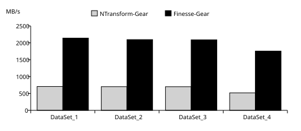
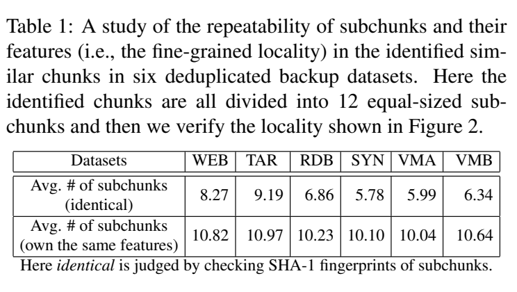
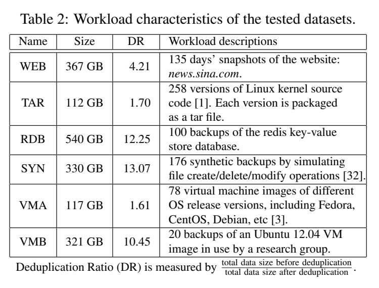
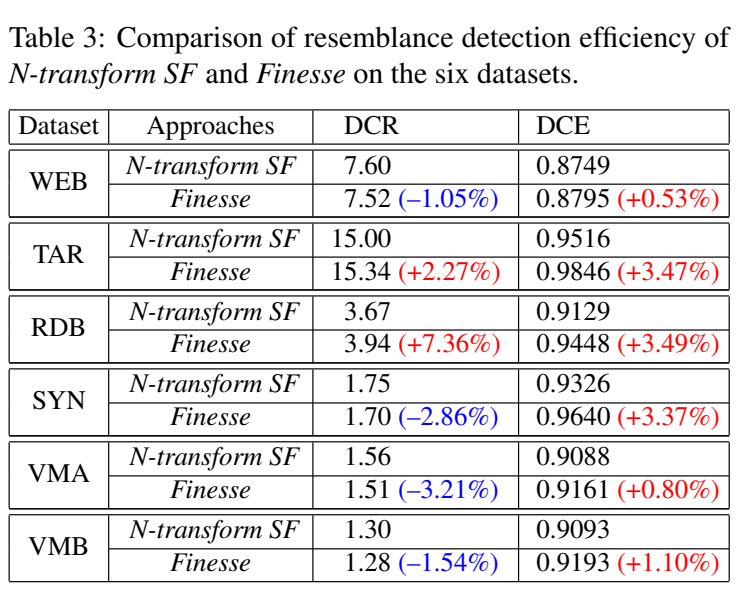
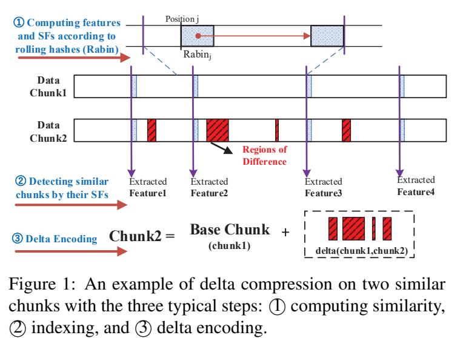
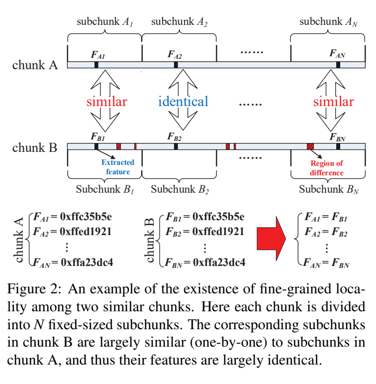
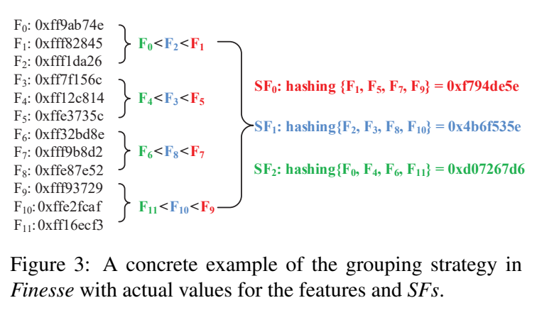
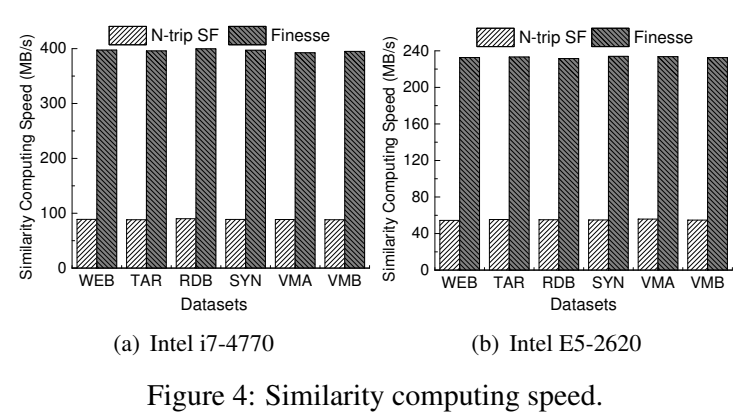
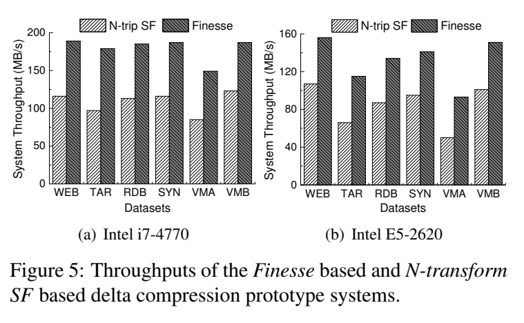

# Finesse 新版统计实验 · 2026-11-24

Apple M5 单线程 Release。构建记录的 Git 提交为 47501bc，本次统计改动来自工作区，实际源码由 raw 中的 source-files.csv 和 SHA-256 标识。四组输入共 17,000 个文件、1,734,815,694 字节。每组分别完成 SF 与 Delta 的 Benchmark 和 Profiling，各模式的算法结果逐项复核。

[本次输入字节归档](../raw/source-inputs.tar) · [清洗与复核脚本](clean/recompute.py) · [逐轮测速](clean/formal-rounds.csv) · [论文原版 PDF](paper/FAST19-Finesse.pdf) · [本次文件 SHA-256](SHA256SUMS) · [上次实验报告](../report.html)

Finesse-Gear 的 SF 速度为基线的 2.98–3.39 倍。单算法内存管线吞吐为 1.13–1.43 倍。展开源码和未压缩 tar 的 Finesse-Gear DCR 仍低 16.77% 和 16.50%。新旧记录的 SF 输出摘要、最终 Raw/Delta 表示、逐块恢复证据逐项相符。

[逐组趋势](clean/trend-comparison.csv) · [结果一致性复核](clean/reproducibility.csv)

## 表 1　对应子块的局部性

每个样本是 NTransform-Gear 实际选中的一个目标块与 Raw 基块对，包含所有匹配尝试。按各自长度等分 12 段，对应位置比较 SHA-1 和 Finesse-Gear 子块最大指纹。两行均值各以候选对数作分母，取值为 0 到 12。第 1 组只有一个样本。

| 指标 | DataSet_1 | DataSet_2 | DataSet_3 | DataSet_4 |
| --- | --- | --- | --- | --- |
| 候选对数 | 1 | 19054 | 14013 | 297 |
| 平均内容相同子块数 | 0.000 | 1.542 | 1.958 | 3.370 |
| 平均 feature 相同子块数 | 0.000 | 8.255 | 8.068 | 5.855 |

[清洗表 1](clean/table1-locality.csv) · [第 1 组逐对原值](raw/supplement/ds1-locality.csv) · [第 2 组逐对原值](raw/supplement/ds2-locality.csv) · [第 3 组逐对原值](raw/supplement/ds3-locality.csv) · [第 4 组逐对原值](raw/supplement/ds4-locality.csv)

## 表 2　工作负载

| 数据集 | 来源 | 文件数 | 大小 GB | 输入字节 | 唯一字节 | DR | 内容 |
| --- | --- | --- | --- | --- | --- | --- | --- |
| DataSet_1 | real | 5 | 0.179762 | 179761540 | 179742046 | 1.0001 | 5 份 Emacs tar.gz |
| DataSet_2 | real | 16982 | 0.636563 | 636563018 | 428027351 | 1.4872 | 5 版 Emacs 展开源码 |
| DataSet_3 | real | 5 | 0.650056 | 650055680 | 473162576 | 1.3739 | 5 份 Emacs tar |
| DataSet_4 | synthetic | 8 | 0.268435 | 268435456 | 41692808 | 6.4384 | 8 份 32 MiB 合成备份 |

GB 使用十进制。DR 为输入字节除以精确去重后的唯一字节。第 4 组使用 FastCDC 已有的 8 份合成备份，生成种子为 20260917。

[清洗表 2](clean/table2-workloads.csv) · [输入清单索引](raw/configs/input-lists/inventory.csv)

## 表 3　去重后的 Delta 压缩效果

DCR 为唯一块原始字节总数除以最终 Raw 与 Delta 的 payload 字节总数。论文对 DCE 同时使用“压缩后/压缩前”和“越高越好”两种描述。本表对全部匹配尝试分别给出剩余比例与节省比例，均按字节加权；无匹配时分母为零，以 — 表示。变化率以同组 NTransform-Gear 为基线。

| 数据集 | 算法 | 匹配 | 接受 Delta | 最终字节 | DCR | DCR 变化 | 匹配剩余比例 | 匹配节省比例 |
| --- | --- | --- | --- | --- | --- | --- | --- | --- |
| DataSet_1 | NTransform-Gear | 1 | 1 | 179734843 | 1.0000 | 基线 | 0.3375 | 0.6625 |
| DataSet_1 | Finesse-Gear | 0 | 0 | 179742046 | 1.0000 | -0.00% | — | — |
| DataSet_2 | NTransform-Gear | 19054 | 19054 | 258893254 | 1.6533 | 基线 | 0.0365 | 0.9635 |
| DataSet_2 | Finesse-Gear | 12424 | 12424 | 311066472 | 1.3760 | -16.77% | 0.0163 | 0.9837 |
| DataSet_3 | NTransform-Gear | 14013 | 14013 | 306479680 | 1.5439 | 基线 | 0.0394 | 0.9606 |
| DataSet_3 | Finesse-Gear | 8597 | 8597 | 367021258 | 1.2892 | -16.50% | 0.0148 | 0.9852 |
| DataSet_4 | NTransform-Gear | 297 | 297 | 36722694 | 1.1353 | 基线 | 0.1501 | 0.8499 |
| DataSet_4 | Finesse-Gear | 140 | 140 | 38559669 | 1.0813 | -4.76% | 0.1370 | 0.8630 |

[清洗表 3（含尝试、接受和全体逐项分子分母）](clean/table3-compression.csv)

## 图 4　SF 计算速度

输入为精确去重后的唯一块，排除短于 12 字节的块。计时从开始提取到写完预分配的签名结果。速度分子为本轮处理的有效唯一字节。

各算法预热一次，五轮正式测量，算法顺序按轮交替。MB/s = 字节 × 1000 / 纳秒。下表为五个逐轮速度的算术平均值 ± 总体标准差，倍数取两算法平均速度之比。

| 数据集 | NTransform-Gear MB/s | Finesse-Gear MB/s | Finesse / NTransform |
| --- | --- | --- | --- |
| DataSet_1 | 706.91 ± 0.74 | 2139.99 ± 2.91 | 3.027× |
| DataSet_2 | 702.29 ± 1.99 | 2096.07 ± 2.72 | 2.985× |
| DataSet_3 | 701.09 ± 2.25 | 2090.51 ± 4.34 | 2.982× |
| DataSet_4 | 518.17 ± 55.21 | 1756.17 ± 123.24 | 3.389× |

## 图 5　内存管线吞吐

每算法、每轮独立进程，启用新版 Benchmark 聚合。计时从读取输入列表、源文件开始，包含文件 SHA-256、CDC、SHA-1 精确去重、SF/索引、Xdelta、即时解码核验，到内存编码池构建完成。分子为全部输入字节；配置解析、CSV 导出、释放原文后的恢复遍历在计时区间外。使用系统正常文件缓存，未清缓存。

各算法预热一次，五轮正式测量，算法顺序按轮交替。MB/s = 字节 × 1000 / 纳秒。下表为五个逐轮速度的算术平均值 ± 总体标准差，倍数取两算法平均速度之比。

| 数据集 | NTransform-Gear MB/s | Finesse-Gear MB/s | Finesse / NTransform |
| --- | --- | --- | --- |
| DataSet_1 | 303.84 ± 4.26 | 425.57 ± 2.08 | 1.401× |
| DataSet_2 | 157.87 ± 3.34 | 197.42 ± 3.20 | 1.251× |
| DataSet_3 | 233.18 ± 32.35 | 334.41 ± 71.47 | 1.434× |
| DataSet_4 | 618.93 ± 5.88 | 696.57 ± 3.49 | 1.125× |

[逐轮正式记录](clean/formal-rounds.csv) · [平均值、标准差及范围](clean/figures4-5-rates.csv) · [含预热的系统吞吐原始记录](raw/supplement/throughput.csv)

## 新版阶段统计与资源

下表取 Delta Benchmark 的单次实跑。输入阶段同一轮只执行一次。耗时以毫秒（ms）表示。file_read 为实际源文件读取，source_sha256 为输入完整性散列。dedup_total 已包含块指纹、索引查找与插入。

| 数据集 | 源读取 ms | 源 SHA-256 ms | CDC ms | 去重 ms |
| --- | --- | --- | --- | --- |
| DataSet_1 | 35.17 | 52.65 | 67.43 | 78.79 |
| DataSet_2 | 2795.89 | 226.31 | 246.09 | 389.05 |
| DataSet_3 | 254.35 | 197.94 | 253.99 | 291.48 |
| DataSet_4 | 54.79 | 95.57 | 126.24 | 132.20 |

编码池构建包含 SF、候选索引、目标和基块摘要、编码与即时回放。构建中的子阶段时长已经包含在构建列里。逐出现块恢复在构建后运行，整文件流式 SHA-256 校验复用同一次恢复的字节。

| 数据集 | 算法 | 构建 ms | SF ms | 查找 ms | Delta 编码 ms | 即时回放 ms | 逐块恢复 ms | 文件摘要累积 ms | 文件摘要核对 ms |
| --- | --- | --- | --- | --- | --- | --- | --- | --- | --- |
| DataSet_1 | Finesse-Gear | 188.25 | 89.80 | 1.87 | — | — | 164.81 | 54.37 | 0.01 |
| DataSet_1 | NTransform-Gear | 355.04 | 255.24 | 2.43 | 0.08 | 0.01 | 149.43 | 54.66 | 0.01 |
| DataSet_2 | Finesse-Gear | 1027.49 | 428.73 | 10.66 | 224.76 | 45.37 | 730.47 | 198.65 | 14.28 |
| DataSet_2 | NTransform-Gear | 1610.84 | 621.03 | 11.12 | 555.10 | 82.43 | 846.18 | 201.08 | 13.12 |
| DataSet_3 | Finesse-Gear | 842.32 | 319.15 | 8.54 | 197.87 | 40.26 | 729.72 | 200.19 | 0.01 |
| DataSet_3 | NTransform-Gear | 1656.18 | 675.03 | 8.48 | 585.40 | 82.78 | 830.63 | 201.41 | 0.11 |
| DataSet_4 | Finesse-Gear | 74.02 | 26.41 | 0.84 | 15.20 | 2.17 | 284.05 | 101.99 | 0.02 |
| DataSet_4 | NTransform-Gear | 184.96 | 110.83 | 1.47 | 25.95 | 3.08 | 268.31 | 96.43 | 0.02 |

Profiling 提供逐次操作与延迟分位数。分位数取每阶段最早 4,096 个观测，累计与平均值覆盖全部调用。第 1 组 Finesse 没有匹配候选，Delta 编码耗时显示为缺失。累计阶段会嵌套，整组墙钟时长以 system_metrics 为准。整组墙钟包含两个算法、完整验证和主要统计文件写出。两种采集模式的单次墙钟只提供资源观测。

| 数据集 | 入口 | 模式 | 处理墙钟 s | 含主要导出墙钟 s | CPU 时间 s | 峰值 RSS MiB |
| --- | --- | --- | --- | --- | --- | --- |
| DataSet_1 | sf | benchmark | 2.796 | 2.797 | 2.739 | 394.2 |
| DataSet_1 | sf | profiling | 2.704 | 2.901 | 2.897 | 411.2 |
| DataSet_1 | delta | benchmark | 1.266 | 1.266 | 1.261 | 698.9 |
| DataSet_1 | delta | profiling | 1.648 | 1.709 | 1.575 | 737.8 |
| DataSet_2 | sf | benchmark | 12.172 | 12.362 | 9.318 | 697.0 |
| DataSet_2 | sf | profiling | 10.686 | 11.541 | 10.311 | 759.3 |
| DataSet_2 | delta | benchmark | 10.126 | 10.629 | 8.210 | 1500.2 |
| DataSet_2 | delta | profiling | 9.570 | 10.483 | 8.367 | 1387.9 |
| DataSet_3 | sf | benchmark | 8.054 | 8.055 | 7.888 | 787.4 |
| DataSet_3 | sf | profiling | 8.776 | 9.238 | 8.980 | 782.2 |
| DataSet_3 | delta | benchmark | 5.735 | 5.737 | 5.503 | 1535.3 |
| DataSet_3 | delta | profiling | 5.722 | 5.947 | 5.706 | 1635.7 |
| DataSet_4 | sf | benchmark | 1.163 | 1.164 | 1.113 | 101.2 |
| DataSet_4 | sf | profiling | 1.130 | 1.190 | 1.181 | 119.5 |
| DataSet_4 | delta | benchmark | 1.505 | 1.506 | 1.455 | 202.2 |
| DataSet_4 | delta | profiling | 1.347 | 1.372 | 1.363 | 227.5 |

[全部阶段](clean/stage-timing.csv) · [编码分布](clean/delta-encoding.csv) · [资源](clean/resources.csv) · [索引](clean/indices.csv) · [存储](clean/storage.csv) · [文件和块恢复](clean/recovery.csv)

## 论文原表与原图

Zhang 等，FAST ’19，论文集 pp. 121–126。下列图片直接截自仓库原版 PDF。原表 1–3 同时转录为 CSV，保留原表 3 印出的 DCR、DCE 和百分比。论文图 4、5 的逐柱精确数值未刊载，保留原图；正文报告的 SF 平均加速为 i7 3.5×、E5 3.2×，系统吞吐提高 41%–85%。原始六数据集为 WEB、TAR、RDB、SYN、VMA、VMB。

[原表 1 CSV](clean/paper-table1.csv)

[原表 2 CSV](clean/paper-table2.csv)

[原表 3 CSV](clean/paper-table3.csv)

本机测量使用 FastCDC、Gear、内存基块和最大 Delta 深度 1。论文使用 Rabin、Destor 流水线、400 MB LRU 基块缓存及 i7-4770/E5-2620 平台。两套数据的工作负载、算法配置和计时条件各见对应表图。

## 复核与原始材料

源代码由 AppleClang 21.0.0 以 Release 构建，CTest 7/7 通过。独立核验逐项比对了输入 SHA-256、manifest 范围、去重映射、候选与恢复摘要。每种模式和每个算法均核对 178,002 次块出现和 17,000 份文件的 SHA-256。每轮补测的输入字节、块数、唯一块数及最终 payload 字节与正式 Delta 实验相符。新旧耗时受采集口径影响，报告用新版同模式内的结果比较算法。

本次逐文件核对四组输入与上次归档中的 SHA-256，字节一致，因此报告直接链接到上次的原始输入 tar。原始目录中的 manifest、候选尝试、恢复摘要和逐轮计时保留程序输出格式。配置的输入清单使用本机绝对路径，清单内及运行输出中的源路径为相对路径。实验源位于仓库同级 FastCDC/Dataset。

| 数据集 | SF 原始计时 | Delta 质量 | 输入摘要 |
| --- | --- | --- | --- |
| DataSet_1 | raw/ds1-sf-benchmark/measurements.csv | raw/ds1-delta-benchmark/compression-summary.csv | raw/ds1-delta-benchmark/source-checksums.csv |
| DataSet_2 | raw/ds2-sf-benchmark/measurements.csv | raw/ds2-delta-benchmark/compression-summary.csv | raw/ds2-delta-benchmark/source-checksums.csv |
| DataSet_3 | raw/ds3-sf-benchmark/measurements.csv | raw/ds3-delta-benchmark/compression-summary.csv | raw/ds3-delta-benchmark/source-checksums.csv |
| DataSet_4 | raw/ds4-sf-benchmark/measurements.csv | raw/ds4-delta-benchmark/compression-summary.csv | raw/ds4-delta-benchmark/source-checksums.csv |

[第 1 组 SF 运行记录](raw/ds1-sf-benchmark/run.txt) · [Delta 运行记录](raw/ds1-delta-benchmark/run.txt) · [候选尝试](raw/ds1-delta-benchmark/delta-attempts.csv) · [恢复校验](raw/ds1-delta-benchmark/restoration-verification.csv)

[第 2 组 SF 运行记录](raw/ds2-sf-benchmark/run.txt) · [Delta 运行记录](raw/ds2-delta-benchmark/run.txt) · [候选尝试](raw/ds2-delta-benchmark/delta-attempts.csv) · [恢复校验](raw/ds2-delta-benchmark/restoration-verification.csv)

[第 3 组 SF 运行记录](raw/ds3-sf-benchmark/run.txt) · [Delta 运行记录](raw/ds3-delta-benchmark/run.txt) · [候选尝试](raw/ds3-delta-benchmark/delta-attempts.csv) · [恢复校验](raw/ds3-delta-benchmark/restoration-verification.csv)

[第 4 组 SF 运行记录](raw/ds4-sf-benchmark/run.txt) · [Delta 运行记录](raw/ds4-delta-benchmark/run.txt) · [候选尝试](raw/ds4-delta-benchmark/delta-attempts.csv) · [恢复校验](raw/ds4-delta-benchmark/restoration-verification.csv)

[第 1 组 SF Profiling 阶段](raw/ds1-sf-profiling/stage_timing.csv) · [Delta Profiling 明细](raw/ds1-delta-profiling/operation_metrics.csv) · [整文件恢复证据](raw/ds1-delta-benchmark/file-restoration.csv)

[第 2 组 SF Profiling 阶段](raw/ds2-sf-profiling/stage_timing.csv) · [Delta Profiling 明细](raw/ds2-delta-profiling/operation_metrics.csv) · [整文件恢复证据](raw/ds2-delta-benchmark/file-restoration.csv)

[第 3 组 SF Profiling 阶段](raw/ds3-sf-profiling/stage_timing.csv) · [Delta Profiling 明细](raw/ds3-delta-profiling/operation_metrics.csv) · [整文件恢复证据](raw/ds3-delta-benchmark/file-restoration.csv)

[第 4 组 SF Profiling 阶段](raw/ds4-sf-profiling/stage_timing.csv) · [Delta Profiling 明细](raw/ds4-delta-profiling/operation_metrics.csv) · [整文件恢复证据](raw/ds4-delta-benchmark/file-restoration.csv)

[输入归档复核脚本](clean/verify_archive.py) · [报告生成脚本](clean/render_report.py)

[CTest 日志](raw/ctest.log) · [四组独立审计](raw/delta-audit.txt) · [原始输入归档核对](raw/archive-audit.txt) · [清洗校验](raw/cleaning-audit.txt) · [补测计时代码](raw/supplement/measure.cpp) · [轮次调度](raw/supplement/run.py)
