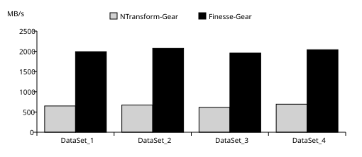
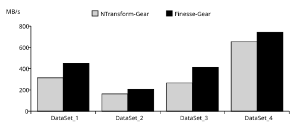
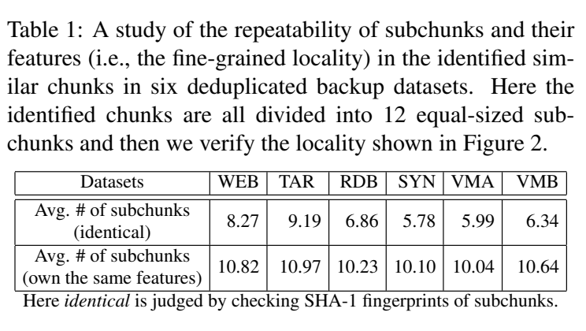
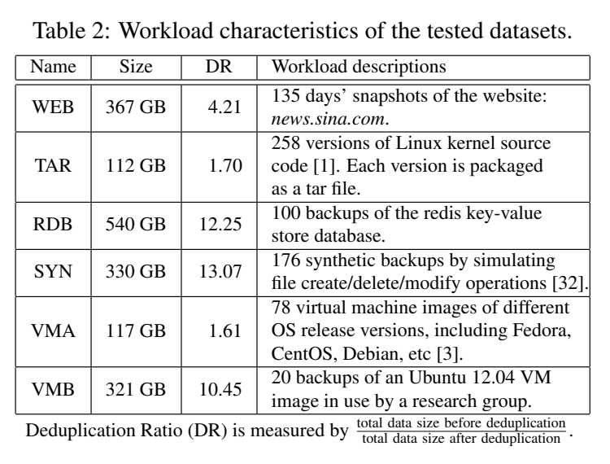
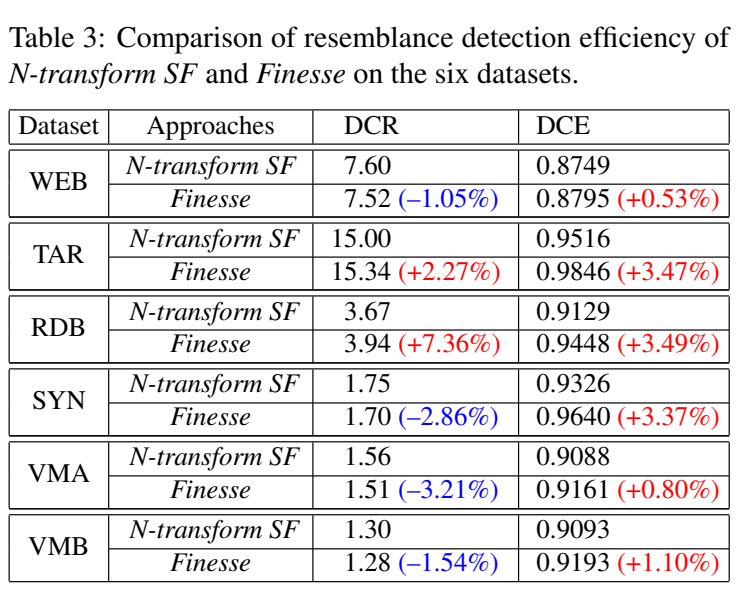
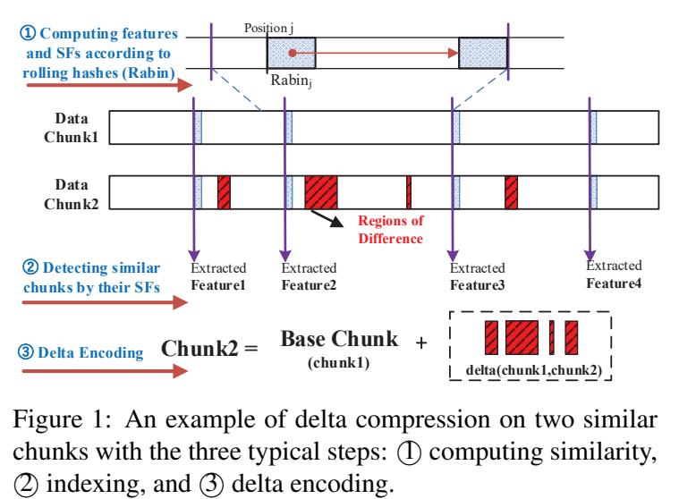
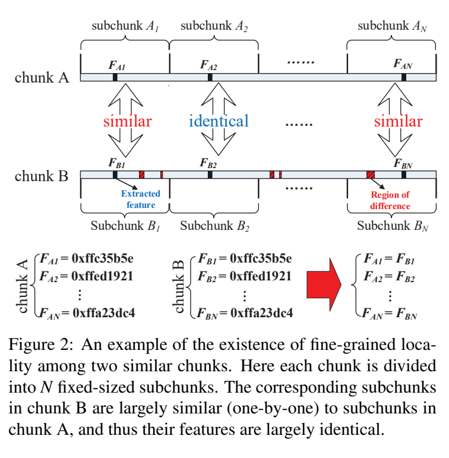
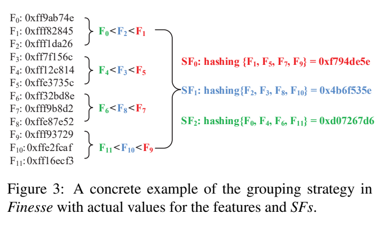
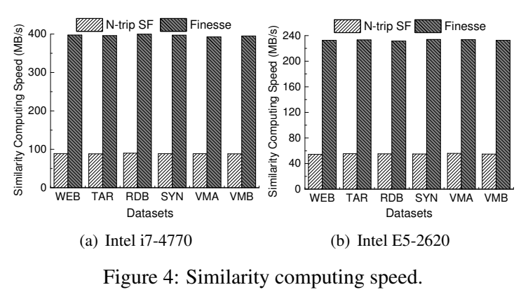
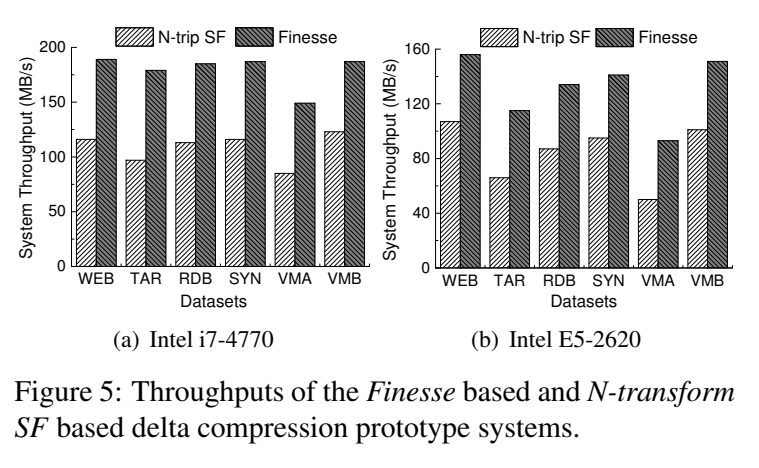

# Finesse 实验记录 · 2026-11-23

Apple M5 单线程 Release，提交 6e4abef。四组共 17,000 个输入文件、1,734,815,694 字节。Finesse-Gear 在四组上计算 SF 更快，增益在完整内存管线中缩小。第 2、3 组中 NTransform-Gear 命中更多候选，最终存储的 payload 也更小。

[原始输入 tar](raw/source-inputs.tar) · [清洗与复核脚本](clean/recompute.py) · [逐轮测速](clean/formal-rounds.csv) · [论文原版 PDF](paper/FAST19-Finesse.pdf) · [交付文件 SHA-256](SHA256SUMS)

## 表 1　对应子块的局部性

每个样本是 NTransform-Gear 实际选中的一个目标块与 Raw 基块对，包含所有匹配尝试。按各自长度等分 12 段，对应位置比较 SHA-1 和 Finesse-Gear 子块最大指纹。两行均值各以候选对数作分母，取值为 0 到 12。第 1 组只有一个样本。

| 指标 | DataSet_1 | DataSet_2 | DataSet_3 | DataSet_4 |
| --- | --- | --- | --- | --- |
| 候选对数 | 1 | 19054 | 14013 | 297 |
| 平均内容相同子块数 | 0.000 | 1.542 | 1.958 | 3.370 |
| 平均 feature 相同子块数 | 0.000 | 8.255 | 8.068 | 5.855 |

[清洗表 1](clean/table1-locality.csv) · [第 1 组逐对原值](raw/supplement/ds1-locality.csv) · [第 2 组逐对原值](raw/supplement/ds2-locality.csv) · [第 3 组逐对原值](raw/supplement/ds3-locality.csv) · [第 4 组逐对原值](raw/supplement/ds4-locality.csv)

## 表 2　工作负载

| 数据集 | 来源 | 文件数 | 大小 GB | 输入字节 | 唯一字节 | DR | 内容 |
| --- | --- | --- | --- | --- | --- | --- | --- |
| DataSet_1 | real | 5 | 0.179762 | 179761540 | 179742046 | 1.0001 | 5 份 Emacs tar.gz |
| DataSet_2 | real | 16982 | 0.636563 | 636563018 | 428027351 | 1.4872 | 5 版 Emacs 展开源码 |
| DataSet_3 | real | 5 | 0.650056 | 650055680 | 473162576 | 1.3739 | 5 份 Emacs tar |
| DataSet_4 | synthetic | 8 | 0.268435 | 268435456 | 41692808 | 6.4384 | 8 份 32 MiB 合成备份 |

GB 使用十进制。DR 为输入字节除以精确去重后的唯一字节。第 4 组使用 FastCDC 已有的 8 份合成备份，生成种子为 20260917。

[清洗表 2](clean/table2-workloads.csv) · [输入清单索引](raw/configs/input-lists/inventory.csv)

## 表 3　去重后的 Delta 压缩效果

DCR 为唯一块原始字节总数除以最终 Raw 与 Delta 的 payload 字节总数。论文对 DCE 同时使用“压缩后/压缩前”和“越高越好”两种描述。本表对全部匹配尝试分别给出剩余比例与节省比例，均按字节加权；无匹配时分母为零，以 — 表示。变化率以同组 NTransform-Gear 为基线。

| 数据集 | 算法 | 匹配 | 接受 Delta | 最终字节 | DCR | DCR 变化 | 匹配剩余比例 | 匹配节省比例 |
| --- | --- | --- | --- | --- | --- | --- | --- | --- |
| DataSet_1 | NTransform-Gear | 1 | 1 | 179734843 | 1.0000 | 基线 | 0.3375 | 0.6625 |
| DataSet_1 | Finesse-Gear | 0 | 0 | 179742046 | 1.0000 | -0.00% | — | — |
| DataSet_2 | NTransform-Gear | 19054 | 19054 | 258893254 | 1.6533 | 基线 | 0.0365 | 0.9635 |
| DataSet_2 | Finesse-Gear | 12424 | 12424 | 311066472 | 1.3760 | -16.77% | 0.0163 | 0.9837 |
| DataSet_3 | NTransform-Gear | 14013 | 14013 | 306479680 | 1.5439 | 基线 | 0.0394 | 0.9606 |
| DataSet_3 | Finesse-Gear | 8597 | 8597 | 367021258 | 1.2892 | -16.50% | 0.0148 | 0.9852 |
| DataSet_4 | NTransform-Gear | 297 | 297 | 36722694 | 1.1353 | 基线 | 0.1501 | 0.8499 |
| DataSet_4 | Finesse-Gear | 140 | 140 | 38559669 | 1.0813 | -4.76% | 0.1370 | 0.8630 |

[清洗表 3（含尝试、接受和全体逐项分子分母）](clean/table3-compression.csv)

## 图 4　SF 计算速度

输入为精确去重后的唯一块，排除短于 12 字节的块。计时从开始提取到写完预分配的签名结果。速度分子为本轮处理的有效唯一字节。

各算法预热一次，五轮正式测量，算法顺序按轮交替。MB/s = 字节 × 1000 / 纳秒。下表为五个逐轮速度的算术平均值 ± 总体标准差，倍数取两算法平均速度之比。

| 数据集 | NTransform-Gear MB/s | Finesse-Gear MB/s | Finesse / NTransform |
| --- | --- | --- | --- |
| DataSet_1 | 649.49 ± 8.61 | 1992.20 ± 16.41 | 3.067× |
| DataSet_2 | 673.93 ± 36.78 | 2074.32 ± 21.32 | 3.078× |
| DataSet_3 | 615.88 ± 33.05 | 1957.82 ± 15.60 | 3.179× |
| DataSet_4 | 693.57 ± 7.38 | 2040.60 ± 52.64 | 2.942× |

## 图 5　内存管线吞吐

每算法、每轮独立进程。计时从读取输入列表、源文件开始，包含文件 SHA-256、CDC、SHA-1 精确去重、SF/索引、Xdelta、即时解码核验，到内存编码池构建完成。分子为全部输入字节；配置解析、CSV 导出、释放原文后的恢复遍历在计时区间外。使用系统正常文件缓存，未清缓存。

各算法预热一次，五轮正式测量，算法顺序按轮交替。MB/s = 字节 × 1000 / 纳秒。下表为五个逐轮速度的算术平均值 ± 总体标准差，倍数取两算法平均速度之比。

| 数据集 | NTransform-Gear MB/s | Finesse-Gear MB/s | Finesse / NTransform |
| --- | --- | --- | --- |
| DataSet_1 | 314.05 ± 1.38 | 450.03 ± 1.33 | 1.433× |
| DataSet_2 | 162.71 ± 2.02 | 204.60 ± 2.49 | 1.257× |
| DataSet_3 | 265.46 ± 0.93 | 411.46 ± 15.78 | 1.550× |
| DataSet_4 | 653.30 ± 0.73 | 741.99 ± 2.35 | 1.136× |

[逐轮正式记录](clean/formal-rounds.csv) · [平均值、标准差及范围](clean/figures4-5-rates.csv) · [含预热的系统吞吐原始记录](raw/supplement/throughput.csv)

## 论文原表与原图

Zhang 等，FAST ’19，论文集 pp. 121–126。下列图片直接截自仓库原版 PDF。原表 1–3 同时转录为 CSV，保留原表 3 印出的 DCR、DCE 和百分比。论文图 4、5 的逐柱精确数值未刊载，保留原图；正文报告的 SF 平均加速为 i7 3.5×、E5 3.2×，系统吞吐提高 41%–85%。原始六数据集为 WEB、TAR、RDB、SYN、VMA、VMB。

[原表 1 CSV](clean/paper-table1.csv)

[原表 2 CSV](clean/paper-table2.csv)

[原表 3 CSV](clean/paper-table3.csv)

本机测量使用 FastCDC、Gear、内存基块和最大 Delta 深度 1。论文使用 Rabin、Destor 流水线、400 MB LRU 基块缓存及 i7-4770/E5-2620 平台。两套数据的工作负载、算法配置和计时条件各见对应表图。

## 复核与原始材料

源代码由 AppleClang 21.0.0 以 Release 构建，CTest 6/6 通过。独立核验逐项比对了输入 SHA-256、manifest 范围、去重映射、候选与恢复摘要。每个算法均核对 178,002 次出现。每轮补测的输入字节、块数、唯一块数及最终 payload 字节与正式 Delta 实验相符。

raw/source-inputs.tar 按 DataSet_1 至 DataSet_4 保存实际参与实验的输入，已逐文件复核归档后的 SHA-256。原始目录中的 manifest、候选尝试、恢复摘要和逐轮计时保留程序输出格式。配置中的相对路径沿用本次仓库布局，实验源位于仓库同级 FastCDC/Dataset。

| 数据集 | SF 原始计时 | Delta 质量 | 输入摘要 |
| --- | --- | --- | --- |
| DataSet_1 | raw/ds1-sf/measurements.csv | raw/ds1-delta/compression-summary.csv | raw/ds1-delta/source-checksums.csv |
| DataSet_2 | raw/ds2-sf/measurements.csv | raw/ds2-delta/compression-summary.csv | raw/ds2-delta/source-checksums.csv |
| DataSet_3 | raw/ds3-sf/measurements.csv | raw/ds3-delta/compression-summary.csv | raw/ds3-delta/source-checksums.csv |
| DataSet_4 | raw/ds4-sf/measurements.csv | raw/ds4-delta/compression-summary.csv | raw/ds4-delta/source-checksums.csv |

[第 1 组 SF 运行记录](raw/ds1-sf/run.txt) · [Delta 运行记录](raw/ds1-delta/run.txt) · [候选尝试](raw/ds1-delta/delta-attempts.csv) · [恢复校验](raw/ds1-delta/restoration-verification.csv)

[第 2 组 SF 运行记录](raw/ds2-sf/run.txt) · [Delta 运行记录](raw/ds2-delta/run.txt) · [候选尝试](raw/ds2-delta/delta-attempts.csv) · [恢复校验](raw/ds2-delta/restoration-verification.csv)

[第 3 组 SF 运行记录](raw/ds3-sf/run.txt) · [Delta 运行记录](raw/ds3-delta/run.txt) · [候选尝试](raw/ds3-delta/delta-attempts.csv) · [恢复校验](raw/ds3-delta/restoration-verification.csv)

[第 4 组 SF 运行记录](raw/ds4-sf/run.txt) · [Delta 运行记录](raw/ds4-delta/run.txt) · [候选尝试](raw/ds4-delta/delta-attempts.csv) · [恢复校验](raw/ds4-delta/restoration-verification.csv)

[CTest 日志](raw/ctest-release.log) · [四组独立审计](raw/delta-audit.txt) · [补测计时代码](raw/supplement/measure.cpp) · [轮次调度](raw/supplement/run.py)
